A veces el rendimiento está mas en el harness que en modelo LLM.

# Lectura 0 - API, SDK, ejemplo de mini harness

## ¿Qué es Harness Engineering?
El **Harness Engineering** (Ingeniería de Andamiajes y Entornos Agénticos) es la disciplina de diseñar, construir y optimizar la infraestructura de software que envuelve a un Modelo de Lenguaje (LLM) para transformarlo de un mero generador estadístico de texto en un **agente de software autónomo, confiable y verificable**.

La ecuación fundamental que rige este paradigma es:
$$\text{Agente} = \text{Modelo (LLM)} + \text{Harness}$$

- **El Modelo (LLM):** Es el motor de inferencia o "cerebro". Posee razonamiento probabilístico, conocimiento semántico y capacidad de sintetizar información, pero carece de extremidades, memoria persistente determinista, acceso al sistema operativo y conciencia de ejecución.
- **El Harness (Arnés):** Es el chasis, sistema nervioso periférico, caja de herramientas, sensores y cinturón de seguridad. Es la capa de software que gobierna:
  1. La **inyección de contexto** (prompts del sistema, mapa del repositorio, restricciones).
  2. El **despachador de herramientas** (*Tool Bus* / ejecución de comandos, lectura y edición de archivos).
  3. El **bucle de ejecución** (*Execution Loop* / ReAct, turnos conversacionales, detección de fin de tarea).
  4. La **persistencia del estado** (bitácoras, memorias de sesión, transacciones ACID).
  5. La **retroalimentación y verificación** (pruebas unitarias, linters, captura de errores en tiempo de ejecución).

> **Tesis del Límite Vinculante (Binding Constraint Thesis):** 
> En tareas de ingeniería complejas en el mundo real (como SWE-bench), la limitación principal para alcanzar el 100% de éxito casi nunca es la inteligencia del modelo, sino la rigidez y las fallas estructurales del harness que lo sostiene.

---

## Sacar al LLM del Chat: Vías de Desacoplamiento
Las interfaces gráficas de chat (como ChatGPT, Claude.ai o Gemini web) son esencialmente **jaulas doradas**: el LLM está atrapado en una caja de arena puramente conversacional donde sólo puede responder con texto plano pasivo para que un humano lo copie y pegue manualmente.

Para que un LLM trabaje como un ingeniero de software real, debemos **sacarlo del chat**. Existen tres vías principales para lograrlo:

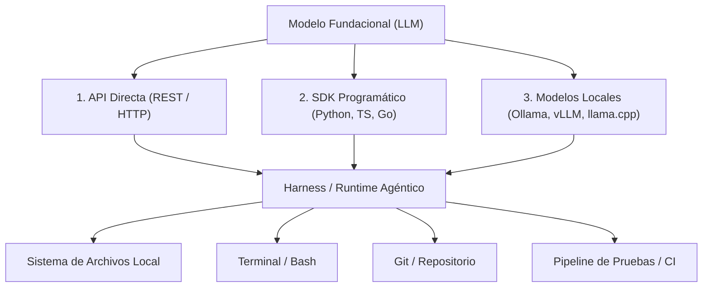

1. **API Directa (HTTP / REST):** Consumo mediante peticiones POST enviando payloads JSON a endpoints como `/v1/chat/completions`. Permite máximo control sobre encabezados, streaming de eventos SSE (Server-Sent Events) y llamadas sin dependencias externas pesadas.
2. **SDK Programático:** Librerías oficiales o de la comunidad (e.g., `openai`, `anthropic`, `google-genai`) que encapsulan la serialización, reintentos automáticos con retroceso exponencial (*exponential backoff*), tipado estricto y abstracción de llamadas a funciones (*Function Calling / Tools*).
3. **Modelos Locales:** Servir modelos abiertos o cuantizados en infraestructura propia (utilizando Ollama, vLLM o `llama.cpp` exponiendo una interfaz compatible con OpenAI). Esto garantiza soberanía de datos, latencia de red cero, costo por token nulo y ejecución offline.

---

## Ejemplo Práctico: Construcción de un Mini Harness SDK en Python
A continuación se presenta un mini harness agéntico completo construido con la librería oficial `openai` (o compatible con cualquier proveedor local que use el protocolo OpenAI, como Ollama o vLLM). 

Este harness implementa:
1. Definición de herramientas reales locales (`read_file`, `write_file`, `execute_bash`).
2. Declaración de esquemas JSON (*Tool Schemas*).
3. Despachador de herramientas (*Tool Dispatcher*).
4. Ciclo de control agéntico ReAct (*Reasoning + Action Loop*).

```python
import os
import json
import subprocess
from openai import OpenAI

# 1. Herramientas Locales Reales (Las manos del modelo)
def execute_bash(command: str) -> str:
    """Ejecuta un comando en la shell del sistema y devuelve stdout + stderr."""
    try:
        res = subprocess.run(
            command, shell=True, capture_output=True, text=True, timeout=30
        )
        return (res.stdout + "\n" + res.stderr).strip() or "[Comando ejecutado con éxito sin salida]"
    except subprocess.TimeoutExpired:
        return "[Error: Tiempo de ejecución excedido (Timeout 30s)]"
    except Exception as e:
        return f"[Error al ejecutar comando: {e}]"

def read_file(path: str) -> str:
    """Lee el contenido textual de un archivo en el disco."""
    try:
        with open(path, "r", encoding="utf-8") as f:
            return f.read()
    except Exception as e:
        return f"[Error al leer archivo {path}: {e}]"

def write_file(path: str, content: str) -> str:
    """Escribe o sobreescribe contenido en un archivo del disco."""
    try:
        os.makedirs(os.path.dirname(os.path.abspath(path)), exist_ok=True)
        with open(path, "w", encoding="utf-8") as f:
            f.write(content)
        return f"[Archivo {path} escrito exitosamente]"
    except Exception as e:
        return f"[Error al escribir archivo {path}: {e}]"

# Tabla de despacho dinámico
TOOL_REGISTRY = {
    "execute_bash": execute_bash,
    "read_file": read_file,
    "write_file": write_file,
}

# 2. Esquemas de Herramientas para el LLM (Function Calling Schemas)
TOOLS = [
    {
        "type": "function",
        "function": {
            "name": "execute_bash",
            "description": "Ejecuta un comando en la shell del sistema.",
            "parameters": {
                "type": "object",
                "properties": {
                    "command": {"type": "string", "description": "Comando bash a ejecutar"}
                },
                "required": ["command"],
            },
        },
    },
    {
        "type": "function",
        "function": {
            "name": "read_file",
            "description": "Lee el contenido de un archivo en el repositorio.",
            "parameters": {
                "type": "object",
                "properties": {
                    "path": {"type": "string", "description": "Ruta del archivo"}
                },
                "required": ["path"],
            },
        },
    },
    {
        "type": "function",
        "function": {
            "name": "write_file",
            "description": "Escribe contenido en un archivo del repositorio.",
            "parameters": {
                "type": "object",
                "properties": {
                    "path": {"type": "string", "description": "Ruta del archivo"},
                    "content": {"type": "string", "description": "Contenido a escribir"},
                },
                "required": ["path", "content"],
            },
        },
    },
]

# 3. El Bucle de Ejecución del Harness (ReAct Agent Loop)
def run_mini_harness(goal: str, max_turns: int = 10):
    client = OpenAI(api_key=os.environ.get("OPENAI_API_KEY", "dummy-key"))
    
    messages = [
        {
            "role": "system",
            "content": (
                "Eres un agente de software autónomo operando dentro de un Harness de ejecución. "
                "Tienes acceso a la shell y a los archivos del proyecto. Resuelve el objetivo paso a paso. "
                "Cuando verifiques que todo está listo, concluye con un mensaje final."
            ),
        },
        {"role": "user", "content": goal},
    ]

    print(f"\n🚀 [Harness] Iniciando ejecución. Objetivo: {goal}\n" + "="*50)

    for turn in range(1, max_turns + 1):
        print(f"\n🔄 [Turno {turn}/{max_turns}] Consultando al LLM...")
        
        response = client.chat.completions.create(
            model="gpt-4o-mini", # O 'llama3' si usas Ollama con base_url
            messages=messages,
            tools=TOOLS,
            tool_choice="auto",
        )
        
        choice = response.choices[0]
        message = choice.message
        messages.append(message)

        # Si el modelo no solicita más herramientas, ha terminado
        if not message.tool_calls:
            print(f"\n✅ [Harness] Agente completó su trabajo:")
            print(message.content)
            break

        # Despachar cada herramienta solicitada por el modelo
        for tool_call in message.tool_calls:
            fn_name = tool_call.function.name
            args = json.loads(tool_call.function.arguments)
            call_id = tool_call.id

            print(f"  🛠️  [Herramienta Solicitada] {fn_name}({args})")
            
            if fn_name in TOOL_REGISTRY:
                result = TOOL_REGISTRY[fn_name](**args)
            else:
                result = f"[Error: Herramienta '{fn_name}' no existe en el registro]"
                
            print(f"  📥 [Resultado] {result[:120]}..." if len(str(result)) > 120 else f"  📥 [Resultado] {result}")

            # Enviar el resultado de vuelta al LLM como mensaje de rol 'tool'
            messages.append({
                "role": "tool",
                "tool_call_id": call_id,
                "content": str(result),
            })
    else:
        print("\n⚠️ [Harness] Límite de turnos alcanzado sin conclusión explícita.")

if __name__ == "__main__":
    # Ejemplo de invocación
    # run_mini_harness("Inspecciona los archivos del directorio actual y crea un archivo hello.txt con la fecha actual.")
    pass
```

Este sencillo código de 120 líneas es la prueba viva del concepto: el modelo genera la intención estructurada (`tool_calls`), pero **es el harness en Python el que ejecuta la orden en la máquina física**, captura la salida y retroalimenta al modelo.

---

## Claude Code, Codex y Antigravity son Harnesses
Muchas personas creen equivocadamente que productos como **Claude Code** (Anthropic), **Codex / ChatGPT Code Interpreter** (OpenAI) o **Antigravity** (Google DeepMind) son "modelos nuevos milagrosos".

La realidad técnica es mucho más contundente: **son harnesses de ingeniería de software de élite construidos alrededor de modelos existentes**.
- **Claude Code:** Es un harness CLI especializado desarrollado en TypeScript/Rust que envuelve al modelo Claude 3.7 / Sonnet, implementando compactación de contexto automática, subagentes especializados, despacho de herramientas seguras de git y shell, y lectura de convenciones (`CLAUDE.md`).
- **Codex / OpenAI Assistants:** Es un harness hospedado con sandboxing de ejecución en contenedores efímeros con micro-ambientes Jupyter y límites estrictos de tiempo de CPU.
- **Antigravity (Google DeepMind):** Es un harness orquestador multi-agente con agentes especializados (Browser, Terminal, Memory Engram, Skills dinámicas) y gestión de proyectos con aislamiento estricto de contexto.

Todos hacen en esencia lo mismo que nuestro mini harness: orquestar el ciclo `LLM -> Tool Call -> Runtime Execution -> Feedback Loop`. La diferencia radica en su robustez, observabilidad, manejo de límites de tokens y control de permisos.

---

## El Espectro de Personalización y la Elección de Pi Agent
Cada uno de estos harnesses comerciales permite ciertos niveles de configuración personalizada (archivos de reglas, variables de entorno, plugins). Sin embargo, presentan grandes desventajas cuando buscamos entender y dominar la ingeniería de andamiajes:
- Tienen capas de abstracción cerradas u opacas.
- Vienen con un volumen masivo de preconfiguraciones rígidas (*framework bloat*).
- Sus prompts de sistema predeterminados consumen miles de tokens antes de que el usuario escriba una sola palabra.
- Están fuertemente acoplados a sus propias plataformas comerciales.

| Harness | Ecosistema | Nivel de Bloatware | Transparencia / Hackabilidad | Curva de Configuración |
| :--- | :--- | :--- | :--- | :--- |
| **Claude Code** | Anthropic / Propietario | Medio (CLI opinionado) | Media (cerrado, extensible con hooks) | Media |
| **OpenAI Assistants** | OpenAI / Cloud cerrado | Alto (caja negra en nube) | Nula (código del servidor inaccesible) | Baja |
| **Antigravity** | Google / Multi-agente | Alto (orquestador completo) | Media-Alta (skills y plugins) | Alta |
| **Pi Agent** | Abierto / Agnóstico | **Casi Cero (Minimalista)** | **100% Código Abierto y Transparente** | **Mínima (Listo para usar)** |

### ¿Por qué usaremos Pi Agent en este curso?
**Pi Agent** (creado por Mario Zechner) representa la máxima expresión de la filosofía de arnés minimalista:
1. **Filosofía de Cero Configuración:** No requiere complejas bases de datos vectoriales, servidores pesados ni frameworks monolíticos.
2. **Cuatro Primitivas Atómicas:** Todo el poder del agente se basa en únicamente cuatro herramientas universales:
   - `read`: Inspección de archivos y directorios con control de límites.
   - `write`: Escritura atómica de archivos completos.
   - `edit`: Reemplazo quirúrgico y exacto de cadenas de texto (diffs precisos).
   - `bash`: Ejecución de comandos del sistema con captura de streams.
3. **Prompt de Sistema Ultraligero:** Su prompt base tiene menos de 1000 tokens, lo que deja el 99% de la ventana de contexto libre para el código del usuario y reduce el costo y la latencia.
4. **Desacoplamiento Total (`pi-ai`):** Se puede conectar indistintamente a OpenAI, Anthropic, Gemini, Groq o modelos locales sin modificar una sola línea del arnés.

Por estas razones, **Pi Agent será nuestro laboratorio y vehículo principal de estudio** a lo largo de este curso: aprenderemos a construir, auditar y afinar el harness más elegante, transparente y poderoso del mercado.

---


# Lectura 1 - Importancia del harness
## Donde los agentes realmente se quedan estancados
- Requisitos vagos — el agente sólo puede adivinar.
- Convenciones implícitas no escritas — el agente no tiene forma de cumplirlas.
- Configuración incompleta del entorno — el agente gasta energía arreglando el entorno.
- Sin métodos de verificación — el agente dice que está listo cuando siente que está listo.
- Pérdida de estado entre sesiones — cada nueva sesión comienza desde cero.
## Definition of Done Claro
Completion criteria:
- New endpoint GET /api/search?q=xxx
- Supports pagination, default 20 items
- Results include highlighted snippets
- All new code passes pytest
- Type checking passes (mypy --strict)
## Conclusiones clave
- La capacidad del modelo y la confiabilidad de la ejecución son dos cosas diferentes. Incluso un pura sangre necesita un buen aparejo.
- Cuando las cosas fallen, revise primero el arnés y luego el modelo. Cambiar de modelo es la opción más cara — y la mayoría de las veces ni siquiera es un problema de modelo.
- Cada fallo es una señal: tu arnés tiene un defecto estructural. Encuéntralo y arréglalo.
- No digas simplemente "el modelo no es lo suficientemente bueno" Trabaje sistemáticamente las cinco capas:
	1. tarea no claramente definida.
	2. contexto insuficiente.
	3. entorno mal configurado.
	4. verificación faltante.
	5. pérdida de estado entre sesiones.
	Nueve de cada diez veces el problema vive en una de esas capas.
- Un`AGENTS.md` archivo podría ser más efectivo que actualizar a un modelo más costoso.

# Lectura 2 - Modelo de 5 subsistemas
## Conceptos clave
- El repositorio es la única fuente de verdad (lo unico que el agente puede ver).
- Proporcione un mapa, no un manual (AGENTS.md de 100 lineas dividido en un `docs/` que se lea a pedido).
- Restringir, no microgestionar (reglas ejecutables de restricción del agente, envez de  instrucciones una por una separa 'agente de trabajo' de 'agente de revisión').
- Retire uno a la vez y observe ().
## El modelo de arnés de cinco subsistemas

![[Pasted image 20261015201819.png]]
- **Crea `AGENTS.md` (o `CLAUDE.md`)** contiene una descripción general y un propósito del proyecto, restricciones estrictas no negociables y enlaces a documentación más detallada.
- **Tools** es el subsistema de herramientas (las manos del LLM).
- **Runtime**: Utilice o para bloquear dependencias, o para especificar versiones en tiempo de ejecución, y Docker o devcontainers para que el entorno sea reproducible.
- **Sistema de estado con `PROGRESS.md`**: qué está hecho, qué está en curso, qué está bloqueado. Actualizar antes de que finalice cada sesión; leer cuando comience la siguiente sesión.
- **Checks y results**: Este es el subsistema con el [[ROI en agentes de IA|ROI]] más alto. Enumere explícitamente los comandos de verificación en `AGENTS.md`.
  Verification commands:
	- Tests: pytest tests/ -x
	- Type check: mypy src/ --strict
	- Lint: ruff check src/
	- Full verification: make check (includes all above)
- **Cuantificación del valor del componente del arnés**: Puedes eliminar cada bloque o cada componente uno por uno para probar los resultados de eso y ver cuánto fracasa el harnes cuando falta cada componente, **eso te hace ver cuáles deben priorizarse más, identificar cuellos de botella y también te puede dar respaldos para justificar decisiones**. Pero si un componente tiene bajo impacto no significa que debas eliminarlo significa que talvez le falta contexto, puede tener un entorno irreproducible o  mal configurado, falta de feedback o que simplemente no se usaba en esa tarea, etc.
## Conclusiones clave
- $\text{Arnés} = \text{Instrucciones} + \text{Herramientas} + \text{Entorno} + \text{Estado} + \text{Comentarios}$. Los cinco subsistemas son esenciales.
- Su arnés determina qué parte de la capacidad del modelo se logra.
- Entre los cinco subsistemas, el subsistema de retroalimentación suele tener la inversión más baja y el mayor rendimiento (ROI). Primero, ejecute correctamente sus comandos de verificación.
- Utilice "pruebas de exclusión de variables controladas" para cuantificar la contribución marginal de cada subsistema; para localizar el cuello de botella real, confíe en los registros de fallas y la atribución, no solo en la ablación.
- El arnés se pudre como lo hace el código. Realice auditorías periódicas y pague la deuda del arnés tal como paga la deuda técnica.
# Lectura 3 - Arquitectura de conocimiento
La unica fuente de verdad es el repositorio lo dicen tanto en OpenIA como en Antropic:
- OpenAI lo afirma claramente en su artículo sobre ingeniería de arneses: la información que no existe en el repositorio no existe para el agente. A esto lo llaman principio de "repositorio como especificación"
- Antropic dice: La recuperabilidad del conocimiento entre sesiones determina directamente las tasas de éxito de la tarea. Y este estado debe existir en el repositorio — porque ese es el único almacenamiento estable y confiable y accesible que tiene el agente.
Este no es un problema de "escribir más documentación" — es un problema de **"colocar la información de decisión en el lugar correcto"**. Una página de 50 líneas `ARCHITECTURE.md` en el `src/api/` directorio es mucho más útil que un documento de diseño de 500 páginas en Confluence que nadie mantiene ni lee.

> "La proximidad importa más que la longitud".

## Visibilidad del conocimiento
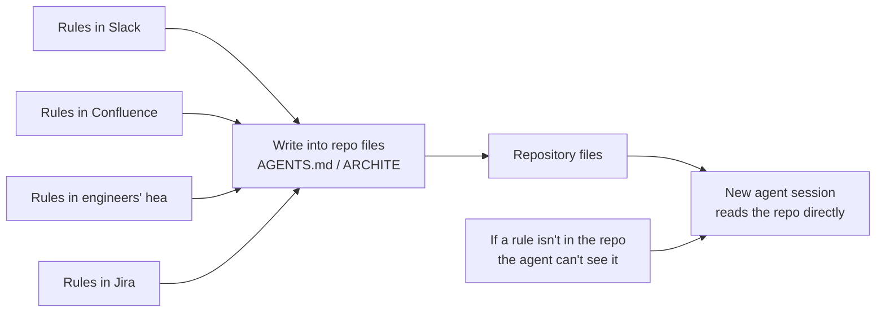

¿Cómo comprobar si tu mapa es lo suficientemente bueno? Ejecute una "prueba de sesión nueva": abra una sesión de agente completamente nueva, asígnele solo el contenido del repositorio y vea si puede responder cinco preguntas básicas.


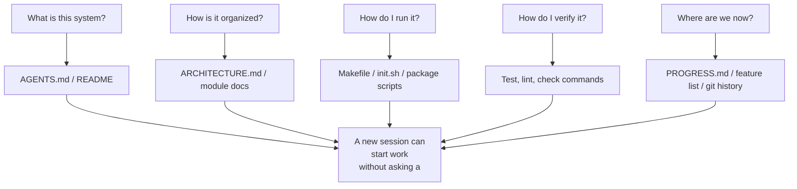
## Cómo dibujar un buen mapa
- **Principio 1**: Poner una archivo markdown en cada modulo que funcione como indice natural, aquí no es bueno poner restricciones de cada archivo de código porque cada archivo de código en si mismo también es un documento que ya contiene sus propias restricciones.
- **Principio 2**: Entre 50 a 100 lineas de un archivo `AGENTS.md` que responda: "Qué es este proyecto", "Cómo está organizado", "Cómo lo ejecuto", "Cómo lo verifico" y "Dónde estamos ahora"
- **Principio 3**: Si eliminar una regla no afecta la calidad de la decisión del agente, esa regla no debería existir. Pero cada pregunta de la prueba de la nueva sesión debe tener una respuesta.
- **Principio 4**: Cada que cambia un código verificar si es necesario actualizar los archivos del arquitectura de cada modulo (del principio 1), a esto puede ayudar el CI (Cotinous Integration).
## Estructura final con los 4 principios
```
project/
├── AGENTS.md              # Entry: project overview, run commands, hard constraints
├── src/
│   ├── api/
│   │   ├── ARCHITECTURE.md  # API layer architecture decisions
│   │   └── ...
│   ├── db/
│   │   ├── CONSTRAINTS.md   # Database operation hard constraints
│   │   └── ...
│   └── ...
├── PROGRESS.md             # Current progress: done, in-progress, blocked
└── Makefile                # Standardized commands: setup, test, lint, check
```

## Gestión del estado del agente con principios ACID
1. **Atomicidad:** Cada cambio o cada operación lógica debe ***concretarse y concluirse*** simple no se puede dejar a medias (actualizando testing y si falla abandonando o integrando parcialmente).
2. **Consistencia**: Después de una operación, el sistema debe estar en un ***estado verificablemente*** correcto (con lint, estado consistente y cero errores).
3. **Aislamiento**: Cada agente utiliza ***su propio archivo de progreso o utiliza ramas de git*** para el aislamiento para evitar cambios de carrera y ediciones simultaneas.
4. **Durabilidad**: El estado temporal puede permanecer en la memoria de la sesión, pero el ***conocimiento que debe sobrevivir en todas las sesiones*** debe escribirse en archivos.

> Una documentación desactualizada es más peligrosa que ninguna documentación

# Lectura 4 - AGENTS.md
Cuando vamos diciendole al agente que "Agregue una regla" por cada bug cada vez se hace mas grande y es ineficiente porque la ventana de contexto toma en cuenta mas que todo lo que está al inicio y al final de un documento extenso (no cumplirá cada regla).

Es peligroso para el agente y los ingenierios porque a veces agregan reglas contradictorias entre sí.

## Principios de una buena estructura de AGENTS.md

1. **Relacion señal ruido (SNR)** La cantidad de instrucciones (señal) debe ser la justa y necesaria para cada tarea, sin redundancia (sin ruido).
2. **Perdido en el medio**: La investigación de Liu et al. de 2023 mostró que los LLM utilizan la información en medio de textos largos de manera significativamente menos efectiva que la información al principio o al final.
3. **Revelar bajo demanda**: proporcione primero información general e información detallada cuando sea necesario. (diviendo las especificaciones en otros lugares ej. `docs/`).
4. **Instrucciones justificadas:** Cada instrucción debe documentar su fuente ("¿por qué se agregó esta regla?"), condición de aplicabilidad ("¿cuándo es necesaria esta regla?") y condición de vencimiento ("¿bajo qué circunstancias se puede eliminar esta regla?").
## Ejemplo

```
# AGENTS.md

## Project Overview
Python 3.11 FastAPI backend, PostgreSQL 15 database.

## Quick Start
- Install: `make setup`
- Test: `make test`
- Full verification: `make check`

## Hard Constraints
- All APIs must use OAuth 2.0 authentication
- All database queries must use SQLAlchemy 2.0 syntax
- All PRs must pass pytest + mypy --strict + ruff check

## Topic Docs
- API Design Patterns (`docs/api-patterns.md`) — Required reading when adding endpoints
- Database Rules (`docs/database-rules.md`) — Required when modifying database operations
- Testing Standards (`docs/testing-standards.md`) — Reference when writing tests
```

# Lectura 5 - Mantener contexto entre sesiones

1. La ventana de contexto por mas que tenga una capacidad de 1M de tokens pierde su rendimiento  entre los 50,000 y 100,000 tokens, y se degrada de forma drástica al superar los 200,000 tokens.
2. Los pasos de razonamiento intermedios contienen el "por qué" de las decisiones,  la salida final solo contiene el "qué" ( el codigo en si ), Las estrategias de compactación generalmente preservan lo último pero pierden lo primero.
3. Antropic en sus agentes introduce la  "ansiedad contextual" que es cuando el agente empieza a saturar su contexto se apresura en terminar las tareas y omitir verificaciones. (para Sonnet 4.5 no es suficiente la compactación pero para Opus 4.5 mayormente si lo es).
4.  Un buen arnés puede comprimir el costo de reconstrucción contextual de 15 minutos a 3 minutos entre cada sesión.
## Flujo de continuidad de sesión
Sin archivos de persistencia de estado, cada nueva sesión debe comenzar desde cero:

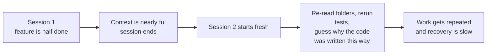

Con los archivos de persistencia de estado, las nuevas sesiones pueden comenzar rápidamente:


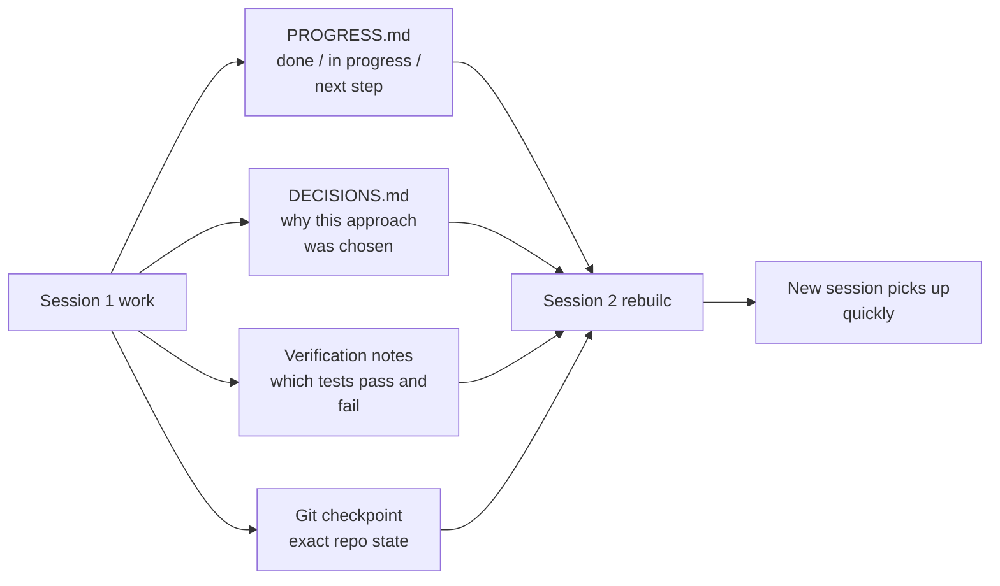

## Enfoques prácticos de la persistencia del Estado
1. Archivo de progreso (PROGRESS.md). El archivo de persistencia de estado más básico:
   
	```
	# Project Progress
	
	## Current State
	- Latest commit: abc1234 (feat: add user preferences endpoint)
	- Test status: 42/43 passing (test_pagination_edge_case failing)
	- Lint: passing
	  
	## Completed
	- [x] User model and database migration
	- [x] Basic CRUD endpoints
	- [x] Auth middleware integration
	
	## In Progress
	- [ ] Pagination feature (90% - edge case test failing)
	
	## Known Issues
	- test_pagination_edge_case returns 500 on empty result sets
	- Need to confirm whether deleted users should appear in listings
	
	## Next Steps
- Fix pagination edge case bug
- Add "include deleted users" query parameter
- Update API documentation
	```
   
2. Registro de decisiones (DECISIONS.md). Registre decisiones y razones de diseño importantes. No es necesario contar con documentos de diseño detallados — simplemente "qué decisión, por qué, cuándo":
 ```
 # Design Decisions

	## 2024-01-15: Use Redis for user preferences caching
	- Reason: High read frequency (every API call), small data size
	- Rejected alternative: PostgreSQL materialized view (high change frequency makes maintenance cost not worthwhile)
	- Constraint: Cache TTL of 5 minutes, active invalidation on write
 ```  
3. Git se confirma como puntos de control. Comprométete después de completar cada unidad atómica de trabajo. Los mensajes de confirmación deben explicar qué se hizo y por qué. Estas son instantáneas de estado gratuitas y con versiones automáticas.
4.  `init.sh` o flujo de inicialización del arnés. Especifique en `AGENTS.md` las rutinas de "entrada y salida":
   ```
   ## At session start (clock in)
	1. Read PROGRESS.md for current state
	2. Read DECISIONS.md for important decisions
	3. Run make check to confirm repo is in consistent state
	4. Continue from PROGRESS.md "Next Steps" section
	
	## Before session end (clock out)
	5. Update PROGRESS.md
	6. Run make check to confirm consistent state
	7. Commit all completed work
   ```
5. Las tareas cortas (menos de 30 minutos) pueden completarse en una sola sesión. Las tareas largas (que abarcan sesiones) deben utilizar archivos de progreso y registros de decisiones para lograr continuidad. Criterio de decisión: si una tarea necesita más del 60% de la ventana, comience a preparar la transferencia.
# Lectura 6 - Inicialización
La fase de inicialización tiene como objetivo maximizar la confiabilidad y eficiencia de todas las implementaciones posteriores.
Cuando se combina inicialización e implementación, el agente enfrenta un problema de optimización multiobjetivo: tiene que construir infraestructura y escribir código de características simultáneamente. 

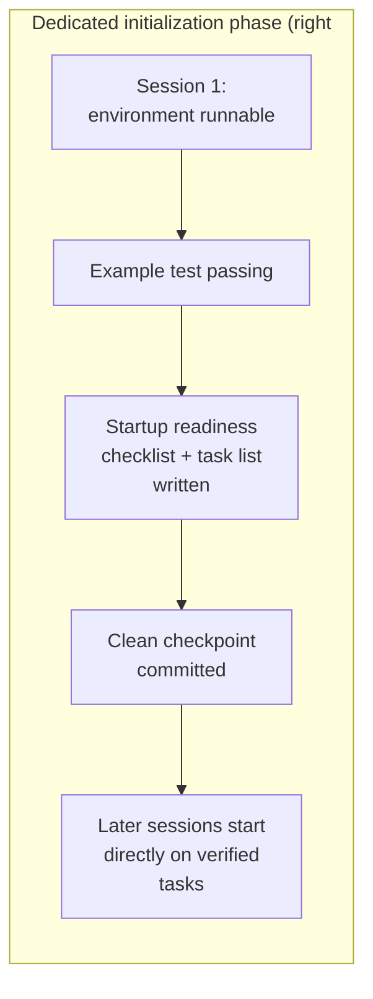
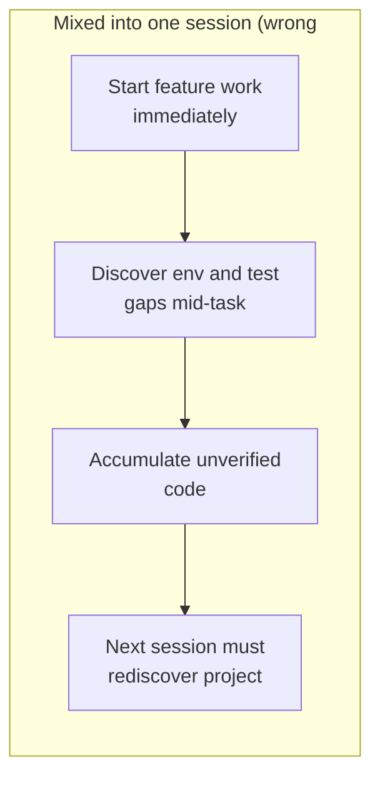
Decisiones que toma el agente durante la inicialización: 
1. Qué marco de prueba.
2. Cómo organizar directorios.
3. Gestión de dependencias. 
Si no se registran explícitamente, las sesiones posteriores pueden tomar decisiones contradictorias pero aún así, si la inicialización es demasiado redudante puede consumir mas tokens que la propia tarea a realizar.

## Cómo realizar la inicialización correctamente

1. Entorno ejecutable. El proyecto comienza, se instalan dependencias, no hay problemas de entorno.
2. Marco de pruebas verificable. Pasa al menos un ejemplo de prueba, lo que demuestra que el marco de prueba en sí está configurado correctamente.
3. Documento de lista de verificación de preparación para la puesta en marcha. Un documento claro que indique las sesiones posteriores `init.md`:
   ```
   # Startup Readiness Checklist
	
	## Start Commands
	- Install dependencies: `make setup`
	- Start dev server: `make dev`
	- Run tests: `make test`
	- Full verification: `make check`
	
	## Current State
	- All dependencies installed and locked
	- Test framework configured (Vitest + React Testing Library)
	- Example test passing (1/1)
	- Lint rules configured (ESLint + Prettier)
	
	## Project Structure
	- src/ — Source code
	- src/components/ — React components
	- src/api/ — API client
	- tests/ — Test files
   ```
4. Desglose de tareas. Divida todo el proyecto en una lista de tareas ordenadas, cada tarea con criterios de aceptación claros:
   ```
   # Task Breakdown

	## Task 1: User Authentication Basics
	- Implement JWT auth middleware
	- Add login/register endpoints
	- Acceptance: pytest tests/test_auth.py all passing
	
	## Task 2: User Profile Page
	- Implement user profile CRUD
	- Add profile edit form
	- Acceptance: pytest tests/test_profile.py all passing
	
	## Task 3: Search Feature
	- ...
   ```
5. Confirmación de Git como punto de control. Una vez completada la inicialización, confirme un punto de control limpio. Todos los trabajos posteriores comienzan desde este punto de control.
6. **Comenzar desde una plantilla:** no comience desde un directorio vacío. Utilice una plantilla de proyecto (create-react-app, fastapi-template, etc.) para preestablecer la estructura de directorio estándar, la configuración de dependencias y el marco de prueba. Incorpore pasos de inicialización comunes a la plantilla, dejando solo el trabajo de inicialización específico del proyecto.
7. **Criterios de finalización de la inicialización:** no "cuánto código se escribió", sino si se cumplen las cuatro condiciones de la lista de verificación de preparación para el inicio: puede iniciar, puede probar, puede ver el progreso, puede seguir los siguientes pasos. Utilice esta lista de verificación para validar la inicialización:
   ```
	   ## Initialization Acceptance Checklist
		- [ ] `make setup` succeeds from scratch
		- [ ] `make test` has at least one passing test
		- [ ] A new agent session can answer "how to run" and "how to test" from repo contents alone
		- [ ] Task breakdown file exists with at least 3 tasks
		- [ ] Everything committed to git
   ```

# Lectura 7 -  Una tarea a la vez
Supongamos que la capacidad de contexto del agente es $C$ y activa $k$ tareas simultáneamente. Cada tarea obtiene un promedio de recursos de razonamiento $C/k$. Cuando $C/k$ cae por debajo del umbral mínimo necesario para completar una sola tarea, ninguna de ellas finaliza.
- Límite WIP (Work-in-Progress Limit): De la metodología Kanban. Idea central: limitar cuántas tareas están en vuelo a la vez. Para los agentes, WIP=1 es el valor predeterminado más seguro: finalizar uno antes de comenzar el siguiente.
- Presión de finalización: la fuerza restrictiva que ejerce el arnés a través de los límites de WIP y los requisitos de evidencia de finalización, lo que obliga al agente a finalizar la tarea actual antes de comenzar una nueva.
- Superficie de alcance: una estructura DAG donde cada nodo es una unidad de trabajo y los bordes son dependencias. Los estados están limitados a cuatro: no_iniciado, activo, bloqueado, aprobado.

## Flujo WIP=1
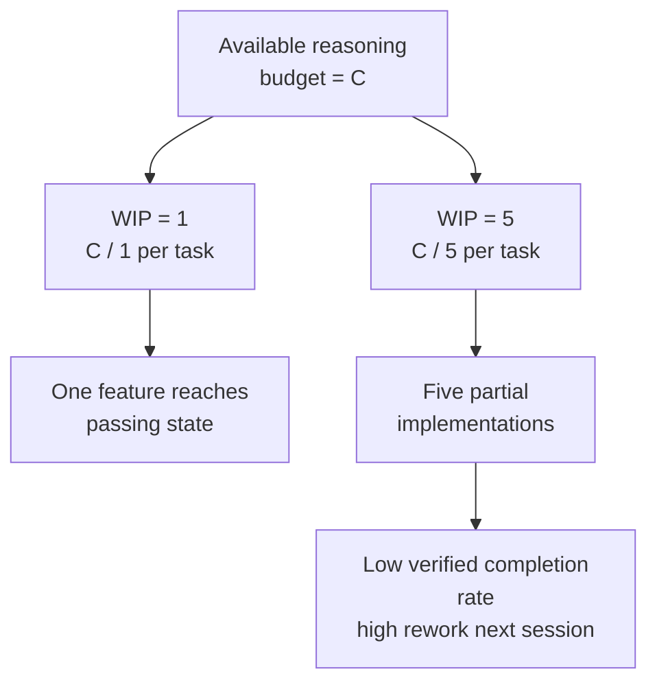
## Overreach y Under-finish son dos caras de la misma moneda
- **Overreach**: El agente activa más tareas en una sola sesión de lo óptimo.
- **Under-finish**: La proporción de tareas que pasan la verificación end-to-end, de todas las tareas activadas, cae por debajo del umbral.
Estos dos problemas no son independientes — se amplifican entre sí. La Overreach diluye la atención, la atención diluida provoca un acabado insuficiente y el código a medio terminar (under-finish) que queda aumenta la complejidad del sistema, lo que impulsa aún más la overeach en la siguiente tarea. Un círculo vicioso.
## Cómo hacerlo bien

1. Hacer cumplir WIP=1: En su arnés, dígale explícitamente al agente: solo se permite una tarea en estado "activo" en cualquier momento. En CLAUDE.md de Claude Code o AGENTS.md de Codex, escribe:
   ```
   ## Work Rules
	- Work on one feature at a time
	- Only start the next feature after the current one passes end-to-end verification
	- Don't "also refactor" feature B while implementing feature A
   ```
2. Definir evidencia de finalización explícita para cada tarea: "Listo" no es "el código está escrito" — es "la verificación del comportamiento pasa" En su lista de funciones, cada entrada necesita un comando de verificación:
   ```
   F01: User Registration
	  Verification: curl -X POST /api/register -d '{"email":"test@example.com","password":"123456"}' | jq .status == 201
	  State: passing
   ```
   3. Externalizar la superficie del alcance (DAG): Utilice un archivo legible por máquina (JSON o Markdown) para registrar todos los estados de las tareas. Cualquier sesión nueva puede leer este archivo y saber inmediatamente: ¿qué tarea está activa? ¿Qué comportamiento se considera realizado? ¿Qué verificaciones han pasado? y es recomendable numerarlos para que se hagan en orden y tener mayor control de los cambios.
   4. Supervisar la tasa de finalización verificada: El arnés debe rastrear continuamente la VCR ($\text{tasa de finalización verificada} = \frac{\text{tareas verificadas}}{\text{tareas activadas}}$). Bloquear nuevas activaciones de tareas cuando VCR < 1.0. (cuando haya mas tareas activadas que verificadas)
## Conclusiones Clave
- **WIP=1 es la configuración segura predeterminada para los arneses de agentes** — finalice uno y luego inicie el siguiente; no intente paralelizar.
- **La evidencia de finalización debe ser ejecutable** — "el código se ve bien" no cuenta; "curl devuelve 201" sí.
- **La superficie de alcance debe externalizarse como un archivo** — no solo mencionado en la conversación, sino grabado en un formato legible por máquina en el repositorio.
- **La extralimitación y el subfinalización son simbióticos** — resolver uno resuelve el otro.
- **"Hacer menos pero terminar" siempre supera a "hacer más pero dejar la mitad hecho" —** las líneas de código del agente y la tasa de finalización de funciones están correlacionadas negativamente. La calidad siempre supera a la cantidad.
# Lectura 8 - Lista de Features (características)
La lista de features es una estructura en la que podemos darle al harness una tarea especifica que tiene un cierto ciclo de vida y esas son las que debemos monitorear hasta el final con una buena definición de "hecho" basado en pruebas end-to-end. Y para esto OpenAI y Antropic enfatizan que: "El estado de la `feature` debe residir en un archivo legible por el harness en el repositorio, no en un texto de conversación no estructurado".

Por ejemplo para la creación de una funcionalidad o caracteristica de un carrito debemos especificarlo de tal manera que responda por lo menos estas preguntas:
- ¿Puede una nueva sesión de agente responder estas preguntas de esta nota? 
- ¿Qué significa "casi hecho"? 
- ¿Qué pruebas pasó el carrito?
- ¿Qué está bloqueando los pagos? 
## Conceptos clave
- **Las listas de características son primitivas del arnés**: no "herramientas de planificación opcionales", sino estructuras de datos fundamentales de las que dependen todos los demás componentes del arnés. El programador, el verificador y el reportero de transferencia deben leer la lista de funciones para funcionar.
- **Triple estructura**: Cada elemento característico contiene tres elementos:`(behavior description, verification command, current state)` . El comportamiento le dice al agente qué hacer, la verificación le dice qué cuenta como hecho y el estado le dice dónde están las cosas. La falta de cualquier elemento hace que el elemento esté incompleto.
- **Modelo de máquina de estados**: cada elemento característico tiene cuatro estados —`not_started` ,`active` ,`blocked` ,`passing` . Las transiciones de estado están controladas por el arnés, no cambiadas libremente por el agente.
- **Puerta de estado de paso:** la única forma en que una función pasa de a es mediante la ejecución exitosa del comando de verificación. Esta transición es irreversible — una vez, no puede volver atrás.`active` o `passing`.
- **Fuente única de verdad**: toda la información sobre "lo que hay que hacer" debe derivar de una lista de características. No hay contradicciones entre la lista de funciones y el historial de conversaciones.
- **Contrapresión**: La cantidad de características que aún no han pasado es la presión que el arnés ejerce sobre el agente. Presión cero = proyecto completado.

## Máquina de estados de características

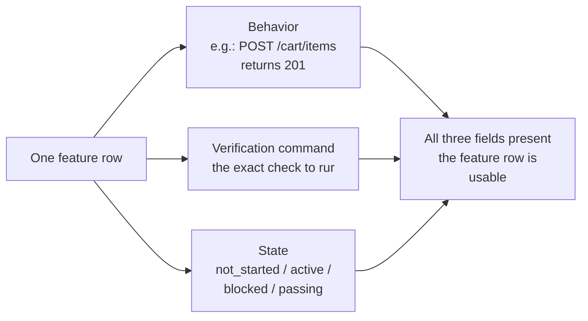
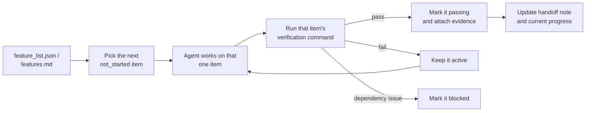


## Estructura de la "Feature List"
Los documentos son para que los lean los humanos; los primitivos son para que los sistemas los ejecuten. Los documentos se pueden ignorar; los primitivos no se pueden omitir. En concreto, la lista de características incluye cuatro componentes del arnés:
1. **Programador**: lee estados y elige la siguiente`not_started` función.
2. **Verificador**: ejecuta comandos de verificación y decide si permite transiciones de estado.
3. **Reportero de transferencia: genera automáticamente resúmenes de** transferencia de sesión a partir de la lista de funciones.
4. **Rastreador de progreso**: cuenta la distribución estatal y proporciona métricas de salud del proyecto.

## Cómo hacerlo
1. Defina un formato de lista de funciones mínimo: No necesita un sistema complejo — un archivo Markdown, JSON o XML estructurado funciona. La clave es que cada entrada debe tener la estructura triple (behavior, verification, state):
   ```
   {
	  "id": "F03",
	  "behavior": "POST /cart/items with {product_id, quantity} returns 201",
	  "verification": "curl -X POST http://localhost:3000/api/cart/items -H 'Content-Type: application/json' -d '{\"product_id\":1,\"quantity\":2}' | jq .status == 201",
	  "state": "passing",
	  "evidence": "commit abc123, test output log"
	}
   ```
2. Deje que las transiciones de estado del control del arnés: El agente no puede cambiar directamente el estado de una característica a `passing` . Sólo puede presentar una solicitud de verificación. El arnés ejecuta el comando de verificación y decide si permite la transición. Esta es una "puerta de paso".
3. Escribe las reglas en CLAUDE.md:
   ```
   ## Feature List Rules
	- Feature list file: /docs/features.md
	- Only one feature active at a time
	- Verification command must pass before marking as passing
	- Don't modify feature list states yourself — the verification script updates them automatically
   ```
4. Calibrar granularidad: Cada elemento destacado debe tener como ámbito "completable en una sola sesión" si es demasiado amplio, no terminará; si es demasiado estrecho, los gastos generales de gestión aumentarán. "El usuario puede agregar artículos al carrito" es una buena granularidad. "Implementar el carrito de compras" es demasiado amplio. "Crear el campo de nombre en el modelo Carrito" es demasiado corto.

**Ejemplo de Modo estructurado**: cada característica tiene un estado claro y un comando de verificación. Una nueva sesión lee la lista de características y en 3 minutos sabe: F01-F05 son`passing` , F06 es`active` (en progreso), F07-F10 son`not_started` . Se retoma directamente desde F06, sin necesidad de reelaborarlo.


# Lectura 9 - Comprobar "DoD"

Desde la especificación de tareas hasta la implementación de código y el comportamiento en tiempo de ejecución, cada transformación puede introducir sesgos y cada verificación omitida agrava la asimetría de la información.

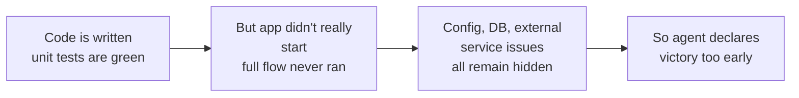

## Conceptos clave
- **Declaración de finalización prematura:** el agente afirma que la tarea está completa, pero aún quedan especificaciones de corrección no cumplidas. El problema central es que el agente juzga basándose en la confianza local a nivel de código, mientras que la corrección a nivel de sistema requiere una verificación global.
- **Sesgo de calibración de confianza**: una brecha sistemática entre la confianza de finalización autoinformada por el agente y la calidad de finalización real. Para tareas complejas de múltiples archivos, este sesgo es significativamente positivo—el agente tiene consistentemente más confianza de la que justifica su desempeño real.
- **Criterios de terminación**: un conjunto claro y ejecutable de condiciones de juicio definidas en el arnés. El agente debe cumplir todas las condiciones antes de declarar la finalización. "Hecho" pasa de un juicio subjetivo a una determinación objetiva.
- **Puerta dual de verificación-validación**: la primera capa (verificación) verifica si el código implementa correctamente el comportamiento especificado; la segunda capa (validación) verifica si el comportamiento a nivel del sistema cumple con los requisitos de extremo a extremo. Ambos deben pasar antes de que la tarea se considere completa.
- **Señales de retroalimentación en tiempo de ejecución: registros,** estados del proceso y controles de estado de la ejecución del programa —estos forman la base objetiva para que el arnés juzgue la calidad de finalización.
- **Restricción de prioridad de finalización**: primero verifique la corrección funcional, luego aborde el rendimiento y, finalmente, maneje el estilo. No se permite ninguna refactorización hasta que se haya verificado la funcionalidad principal.
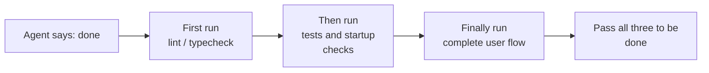
## Errores comunes
- **Aprobar pruebas unitarias ≠ Tarea completada:**  el renderizador pasa una ruta de archivo relativa al script de precarga, pero el script de precarga espera una ruta absoluta. Sus respectivas pruebas unitarias utilizan simulacros y ambas pasan. El problema sólo surge durante las pruebas de extremo a extremo.
- **"Refactorizar mientras estamos en ello" es veneno para el juicio de finalización:** Claude Code tiene un patrón de comportamiento común: comienza a refactorizar el código, optimizar el rendimiento y mejorar el estilo antes de que la funcionalidad principal haya pasado la verificación. El dicho de Knuth de que "la optimización prematura es la raíz de todos los males".
- **Sesgo sistemático en la autoevaluación:** Cuando se le pide a un agente que evalúe su propio trabajo, sistemáticamente proporciona evaluaciones demasiado positivas. La solución no es hacer que el agente sea "más objetivo" El mismo modelo genera y evalúa, por lo que inherentemente tiende a ser generoso consigo mismo.  La solución es separar al "trabajador" del "verificador".
## Cómo prevenir las declaraciones de finalización prematura

### 1. Externalizar la sentencia de rescisión

> Mismo modelo y rapidez, diferentes tiempos de ejecución y presupuestos de costos. Esta es una comparación de aplicaciones informada, no un experimento de igual presupuesto que aísla un componente del arnés. El juego principal funcionó, pero persistieron errores y limitaciones. [Atropic](https://www.anthropic.com/engineering/harness-design-long-running-apps)

La sentencia de finalización no debe ser dictada por el propio agente. El arnés ejecuta de forma independiente la validación de terminación, utilizando señales de tiempo de ejecución como entrada en lugar de la confianza del agente. En `CLAUDE.md`, puedes deletrear esto:

```
## Definition of Done
- Feature complete = end-to-end verification passed, not "code is written"
- Required verification levels:
  1. Unit tests pass
  2. Integration tests pass
  3. End-to-end flow verification passes
- Do not proceed to level 2 if level 1 fails
- Do not proceed to level 3 if level 2 fails
```

### 2. Construya una validación de terminación de tres capas

- **Capa 1: Sintaxis y análisis estático**. El menor costo, la menor información, pero debe aprobarse. Este es el mínimo indispensable—debes escribir las palabras correctamente antes de seguir leyendo.
- **Capa 2: Verificación del comportamiento en tiempo de ejecución**. Ejecución de pruebas, comprobaciones de inicio de aplicaciones, validación de rutas críticas. Esta es la evidencia central de la finalización—no solo escrita, sino ejecutable.
- **Capa 3: Confirmación a nivel de sistema**. Pruebas de extremo a extremo, validación de integración, simulación de escenarios de usuario. La última línea de defensa contra las declaraciones prematuras—no sólo ejecutable, sino correcta.

### 3. Proporcionar comentarios de errores procesables al agente

OpenAI introdujo un patrón particularmente efectivo en su práctica del Codex: **los mensajes de error escritos para los agentes deben incluir instrucciones de reparación**. No se limite a decirle al agente "está mal"—señale exactamente qué está mal y cómo solucionarlo. No use ,`"Test failed"` use`"Test failed: POST /api/reset-password returned 500. Check that the email service config exists in environment variables. The template file should be at templates/reset-email.html."` Este tipo de retroalimentación específica y procesable permite que el agente se autocorrija sin intervención humana.

### 4. Capturar señales en tiempo de ejecución

Las señales de tiempo de ejecución efectivas incluyen:

- ¿La aplicación se inició correctamente y alcanzó un estado listo?
- ¿Las rutas de características críticas se ejecutaron correctamente en tiempo de ejecución?
- ¿Fueron correctas las escrituras de bases de datos, las operaciones de archivos y otros efectos secundarios?
- ¿Se limpiaron los recursos temporales?

> Aprovechar la intervención: se aplica la validación de terminación—(1) iniciar la aplicación completa para verificar que el punto final de reinicio sea accesible; (2) ejecutar el flujo de reinicio completo; (3) verificar la coherencia del estado de la base de datos. Todos los defectos se descubrieron durante la sesión, lo que permitió ahorrar entre 5 y 10 veces el costo de las correcciones post hoc.

# Lectura 10 -  Pipeline de verificación completo
## Conceptos clave
- **Defectos en los límites de los componentes**: los componentes A y B pasan cada uno sus pruebas unitarias, pero su interacción produce un comportamiento incorrecto. Esta es la categoría de problema que las pruebas de extremo a extremo logran detectar.
- **Gradiente de adecuación de las pruebas**: Defectos detectables mediante pruebas unitarias <= defectos detectables mediante pruebas de integración <= defectos detectables mediante pruebas de extremo a extremo. La capacidad de detección aumenta con cada capa.
- **Reglas de cumplimiento de límites arquitectónicos: convertir** reglas de documentos de arquitectura (como "el proceso de renderizado no debe acceder directamente al sistema de archivos") en verificaciones ejecutables y automatizadas — pasando de "escritas en papel" a "ejecutándose en CI"
- **Promoción de comentarios de revisión:** conversión de comentarios recurrentes de revisión de código en pruebas automatizadas. Cada vez que se encuentra una nueva categoría de problema repetido, agregue una regla y el arnés se fortalecerá automáticamente.
- **Mensajes de error orientados al agente: los** mensajes de falla no solo deben indicar "qué salió mal", sino también indicarle al agente exactamente cómo solucionarlo, convirtiendo las fallas de las pruebas en bucles de retroalimentación autocorrectores.
## Cómo hacerlo

### 0. Defina límites arquitectónicos antes de escribir pruebas E2E

El requisito previo para las pruebas de e2e es que el sistema tenga límites claros. Si la arquitectura es un desastre enredado, las pruebas de e2e solo probarán que "todo el desastre funciona" sin decirle dónde se violó la intención del diseño.

Experiencia de OpenAI: para las **bases de código generadas por agentes, las restricciones arquitectónicas deben establecerse como requisitos previos tempranos desde el primer día — no es algo en lo que pensar una vez que el equipo ha crecido.** La razón es sencilla: los agentes copian patrones existentes en el repositorio, incluso cuando esos patrones son inconsistentes o subóptimos. Sin restricciones arquitectónicas, los agentes introducen más deriva con cada sesión.

OpenAI adoptó una "Arquitectura de dominio en capas", donde cada dominio comercial se divide en capas fijas: Tipos -> Configuración -> Repo -> Servicio -> Tiempo de ejecución -> UI. Las dependencias fluyen estrictamente hacia adelante y las preocupaciones entre dominios ingresan a través de interfaces explícitas de proveedores. Cualquier otra dependencia está prohibida y se aplica mecánicamente mediante linting personalizado.

Principio clave: **aplicar invariantes; no microgestionar la implementación.** Por ejemplo, requiera que "los datos se analicen en el límite", pero no prescriba qué biblioteca utilizar. Los mensajes de error deben incluir instrucciones de reparación — no solo decir "violación", sino decirle al agente concretamente cómo cambiarla.

> Fuente: Open[AI: Ingeniería de arnés: aprovechar el Codex en un mundo que prioriza a los agentes](https://openai.com/index/harness-engineering/)

### 1. El arnés debe incluir una capa de extremo a extremo

Hágalo explícito en su flujo de validación: para tareas que involucran cambios entre componentes, pasar pruebas de extremo a extremo es un requisito previo para completarlas:

```
## Validation Hierarchy
- Level 1: Unit tests (Must pass)
- Level 2: Integration tests (Must pass)
- Level 3: End-to-end tests (Must pass when cross-component changes are involved)
- Skipping any required level = Not Complete
```

### 2. Convierta las reglas arquitectónicas en controles ejecutables

Cada restricción arquitectónica debe tener una regla de prueba o pelusa correspondiente:

```
# Check whether the renderer process directly calls Node.js APIs
grep -r "require('fs')" src/renderer/ && exit 1 || echo "OK: no direct fs access in renderer"
```

### 3. Mensajes de error orientados al agente de diseño

Los mensajes de error deben contener tres elementos: qué salió mal, por qué y cómo solucionarlo:

```
ERROR: Found direct import of 'fs' in src/renderer/App.tsx:12
WHY: Renderer process has no access to Node.js APIs for security
FIX: Move file operations to src/preload/file-ops.ts and call via window.api.readFile()
```

### 4. Establecer un proceso de promoción de comentarios de revisión

Cada vez que descubra una nueva categoría de error de agente durante la revisión del código, conviértala en una verificación automatizada. Un mes después tu arnés será mucho más fuerte que a principios de mes.
# Lectura 11 - Agente Observable
## Conceptos clave
- **Observabilidad en tiempo de ejecución**: señales a nivel de sistema que incluyen registros, seguimientos, eventos de proceso y controles de estado. Responde "qué hizo el sistema"
- **Observabilidad del proceso**: Visibilidad de los artefactos de decisión del arnés, incluidos planes, rúbricas de puntuación y criterios de aceptación. Respuestas "por qué debería aceptarse este cambio"
- **Seguimiento de tareas: un** registro completo de la ruta de decisión desde el inicio hasta la finalización de la tarea, análogo al seguimiento de solicitudes en sistemas distribuidos. Cada paso que da el agente, junto con su contexto, se registra — para que cuando algo salga mal, puedas reproducir todo el proceso.
- **Contrato sprint:** acuerdo a corto plazo negociado antes de que comience la codificación, que especifica el alcance de la tarea, los estándares de verificación y las exclusiones. La herramienta central para la observabilidad de procesos.
- **Rúbrica del evaluador:** Transforma la evaluación de la calidad del juicio subjetivo a una puntuación estructurada basada en evidencia, lo que permite que diferentes evaluadores lleguen a conclusiones similares para el mismo resultado.
- **Observabilidad en capas**: observabilidad en capas de sistema y de proceso diseñadas simultáneamente y reforzándose entre sí. Las señales de tiempo de ejecución explican el comportamiento; los artefactos del proceso explican la intención.
- Quizás estés pensando: "¿No puede el agente simplemente imprimir sus propios registros?" El problema es:
	1.  Los agentes no saben lo que no saben. No registrarán de forma proactiva señales que no se dan cuenta de que necesitan. Sin restricciones a nivel de arnés, los agentes solo registran lo que creen que es importante — y lo que creen que es importante generalmente no es suficiente.
	2. Los formatos de registro son inconsistentes. Diferentes sesiones utilizan diferentes formatos de registro, lo que hace imposible el análisis sistemático.
	3. La observabilidad del proceso no se puede resolver mediante el registro. Los contratos de sprint y las rúbricas de puntuación son artefactos estructurados que requieren soporte a nivel de arnés — agregar algunas declaraciones impresas no será suficiente.
## Cómo hacerlo
### 1. Cree una colección de señales de tiempo de ejecución en el arnés

No confíe en que el agente imprima sus propios registros. El arnés debería recoger automáticamente las siguientes señales:

- **Ciclo de vida de la aplicación**: estados de inicio, preparación, ejecución y fase de apagado
- **Ejecución de rutas de funciones**: registros de ejecución de rutas críticas, incluidos puntos de entrada, puntos de control y salidas
- **Flujo de datos**: Registros de datos que fluyen entre componentes
- **Utilización de recursos**: patrones anormales de uso de recursos (por ejemplo, memoria en continuo crecimiento)
- **Errores y excepciones**: contexto de error completo, no solo mensajes de error

### 2. Implementar contratos Sprint

Antes de comenzar cada tarea, el generador y el evaluador (que pueden ser diferentes invocaciones del mismo agente) negocian un contrato que define qué construir y cómo se ve "hecho":

```
# Sprint Contract: Dark Mode Support

## Scope
- Modify the theme toggle component
- Update global CSS variables
- Add dark mode tests

## Verification Standards
- Visual regression tests pass for each component
- Main flow end-to-end tests pass
- No flash of unstyled content (FOUC)

## Exclusions
- Not handling print styles
- Not handling third-party component dark mode
```

### 3. Establecer una rúbrica del evaluador

Convierta "es bueno o no" en una puntuación cuantificable:

```
# Scoring Rubric

| Dimension | A | B | C | D |
|-----------|---|---|---|---|
| Code correctness | All tests pass | Main flow passes | Partial pass | Build fails |
| Architecture compliance | Fully compliant | Minor deviations | Obvious deviations | Serious violations |
| Test coverage | Main + edge cases | Main flow only | Only skeleton | No tests |
```

### 4. Estandarizar con OpenTelemetry

Cree un seguimiento para cada sesión de arnés, un intervalo para cada tarea y subpasos para cada paso de verificación. Utilice atributos estándar para anotar información clave. De esta manera, los datos de observabilidad se integran con cadenas de herramientas estándar (Jaeger, Zipkin).

## Experimento de arquitectura de tres agentes de Anthropic

Esta tabla describe el arnés Opus 4.6 actualizado: una arquitectura con tres agentes, no tres arquitecturas. Se eliminó la descomposición del sprint. El planificador crea la especificación; el constructor la implementa; el evaluador prueba la aplicación en ejecución y envía comentarios para otra ronda de compilación. Antrópico: resultados actualizados del arnés[](https://www.anthropic.com/engineering/harness-design-long-running-apps)

|Agente y fase|Duración|Costo|
|---|---|---|
|Planificador|4,7 min|$0,46|
|Construir ronda 1|2 h 7 min|$71,08|
|Ronda 1 de control de calidad|8,8 min|$3,24|
|Construir ronda 2|1 hora 2 min|$36,89|
|Ronda 2 de control de calidad|6,8 min|$3,09|
|Construir ronda 3|10,9 min|$5,88|
|Ronda 3 de control de calidad|9,6 min|$4.06|
|**Total**|**3 h 50 min**|**$124,70**|

Cada uno de los tres agentes tuvo un papel distinto y cada uno jugó un papel claro en la observabilidad:

Ejemplo de comentarios de la primera ronda de control de calidad: "Esta es una aplicación visualmente impresionante con una buena integración de IA, pero varias características principales de DAW son solo de presentación y carecen de profundidad de interacción: los clips no se pueden arrastrar ni mover, no hay un panel de interfaz de usuario de instrumentos (perillas de sintetizador, almohadillas de batería) ni un editor de efectos visuales (curvas de ecualización, medidores de compresor)" Estos no son casos extremos — son las interacciones centrales que hacen que un DAW sea utilizable. Comentarios específicos respaldados por evidencia — no "no se siente bien"

El evaluador no siempre fue tan agudo. Las primeras versiones identificaban cuestiones razonables y luego se convencían a sí mismas de descartarlas por no ser graves y, en última instancia, aprobaban el trabajo. La solución: lea los registros del evaluador, encuentre los puntos en los que su juicio divergió del juicio humano y actualice el mensaje de control de calidad para abordar esos problemas específicos. Después de varias rondas de este ciclo de desarrollo, la puntuación del evaluador se volvió confiable.

# Lectura 12 - Final de sesion limpio
## Conceptos clave
- **Estado limpio:** el sistema debe satisfacer cinco condiciones al final de la sesión — pases de compilación, pases de pruebas, progreso registrado, sin artefactos obsoletos, ruta de inicio disponible. Faltar cualquiera significa que la sesión no está "terminada"
- **Integridad de la sesión: análo**ga a las transacciones de la base de datos — ya sea confirmarse por completo y dejar un estado limpio, o volver al último estado consistente. No hay término medio.
- **Documento de calidad**: Un artefacto activo que registra continuamente las calificaciones de calidad de cada módulo. No se trata de una evaluación única, sino de un rastreador que muestra si el código base se fortalece o se debilita con el tiempo.
- **Bucle de limpieza**: una sesión de mantenimiento regular destinada a reducir sistemáticamente la entropía en el código base. No es una solución de emergencia, sino operaciones de rutina.
- **Simplificación del arnés**: a medida que mejoran las capacidades del modelo, retire periódicamente los componentes del arnés que ya no sean necesarios. Una limitación esencial hoy en día puede ser la de gastos generales innecesarios en tres meses.
- **Limpieza idempotente: las** operaciones de limpieza producen el mismo resultado independientemente de cuántas veces se ejecuten, lo que garantiza que la limpieza siga siendo segura incluso en escenarios de falla-reintento.
## "Limpiar más tarde" significa nunca limpiar

La trampa mental más común es "no hay tiempo para limpiar esta sesión, lo haré la próxima vez" Pero la siguiente sesión del agente no sabe lo que dejaste atrás — ve un lío de código y un estado incierto. Pasará mucho tiempo infiriendo "qué partes de este código son intencionales y cuáles son temporales"

Peor aún, cada sesión tiene sus propios objetivos de tarea. La nueva sesión está ahí para hacer un nuevo trabajo, no para limpiar el desorden de la sesión anterior. Ignorará el caos y comenzará un nuevo trabajo sobre él, introduciendo aún más caos. Éste es el circuito de retroalimentación positiva de la entropía.
## Cómo hacerlo

### 1. El estado limpio es una condición necesaria para su finalización

Defina explícitamente en el arnés: finalización de **sesión = la tarea pasa la verificación Y la verificación del estado limpio pasa.** Faltar cualquiera de los dos significa que la sesión no está completa. Escribe en CLAUDE.md:

```
## Session Exit Checklist
- [ ] Build passes (npm run build)
- [ ] All tests pass (npm test)
- [ ] Feature list updated
- [ ] No debug code remaining (console.log, debugger, TODO)
- [ ] Standard startup path available (npm run dev)
```

### 2. Estrategia de limpieza de modo dual

Combine dos modos de limpieza:

**Limpieza inmediata (al final de cada sesión): limpie los** artefactos temporales creados durante la sesión, actualice el estado de la lista de funciones, asegúrese de que la compilación y las pruebas pasen. Esto es limpieza de "conteo de referencias" — limpieza tan pronto como termines de usar algo.

**Limpieza periódica (semanal)**: escaneo completo del sistema — maneja problemas estructurales acumulados, actualiza documentos de calidad, ejecuta pruebas comparativas para detectar desviaciones. Esta es una limpieza de "rastreo" — un pase de mantenimiento integral que se realiza con una cadencia regular.

### 3. Mantener un documento de calidad

Un documento de calidad es un artefacto activo que puntúa continuamente cada módulo:

```
# Quality Document

## User Authentication Module (Quality: A)
- Verification passing: Yes
- Agent understandable: Yes
- Test stability: Stable
- Architecture boundaries: Compliant
- Code conventions: Followed

## Payment Module (Quality: C)
- Verification passing: Partial (payment callback untested)
- Agent understandable: Difficult (logic spread across 3 files)
- Test stability: Unstable (2 flaky tests)
- Architecture boundaries: Violations present
- Code conventions: Partially followed
```

Las nuevas sesiones leen este documento y saben inmediatamente dónde priorizar. Primero arregle el módulo con la puntuación más baja.

### 4. Simplifique periódicamente el arnés

Todos los componentes del arnés existen porque el modelo no podría hacer algo por sí solo de manera confiable. Pero a medida que los modelos mejoran, estos supuestos quedan obsoletos.

Esta tabla describe el arnés Opus 4.6 actualizado: una arquitectura con tres agentes, no tres arquitecturas. Se eliminó la descomposición del sprint. El planificador crea la especificación; el constructor la implementa; el evaluador prueba la aplicación en ejecución y envía comentarios para otra ronda de compilación. Antrópico[](https://www.anthropic.com/engineering/harness-design-long-running-apps)

Pero el evaluador contó una historia diferente. Incluso con las capacidades más fuertes de Opus 4.6, cuando las tareas se acercaban al límite de capacidad del modelo, el evaluador aún brindaba valor real — al detectar la funcionalidad faltante del generador y las implementaciones de stub. Esto significa que el evaluador no es una decisión fija de sí o no; depende de dónde se encuentra la dificultad de la tarea en relación con la capacidad del modelo.

**Práctica recomendada**: cada mes, elija un componente del arnés, deshabilítelo temporalmente y ejecute tareas de referencia. Si los resultados no se degradan, elimínelo permanentemente. Si es así, restaúrelo o reemplácelo con una alternativa más liviana.

Un principio más profundo: a **medida que los modelos mejoran, las combinaciones interesantes de un arnés no se encogen — cambian.** Los problemas que antes requerían soluciones explícitas son absorbidos por las capacidades del modelo, pero los nuevos límites de capacidad abren espacios de diseño de arneses que antes eran imposibles. El trabajo del ingeniero de IA es encontrar continuamente la siguiente combinación valiosa.

### 5. Las operaciones de limpieza deben ser idempotentes

Los scripts de limpieza deben poder ejecutarse repetidamente de forma segura — ejecutarlos una vez más no debería producir efectos secundarios:

```
# Idempotent cleanup operations
rm -f /tmp/debug-*.log  # -f ensures no error when files don't exist
git checkout -- .env.local  # Restore to known state
npm run test  # Verify cleanup didn't break anything
```

### 6. El alto rendimiento cambia la filosofía de fusión

Cuando la producción de los agentes excede con creces la capacidad de revisión humana, es necesario ajustar la filosofía de fusión tradicional. La experiencia del equipo de OpenAI: en un entorno donde un agente abre 3,5 PR por día (y luego aún más), minimizar el bloqueo de las puertas de fusión es la decisión correcta. Los PR deben ser de corta duración; la inestabilidad de las pruebas generalmente se resuelve con ejecuciones posteriores en lugar de bloquear el progreso indefinidamente. En un sistema donde el costo de reparación es bajo y el costo de espera es alto, moverse rápido con reparaciones rápidas es una mejor estrategia que una confirmación lenta.

**Advertencia**: esto es irresponsable en un entorno de bajo rendimiento. Pero cuando la producción de agentes excede con creces la atención humana, a menudo es la compensación correcta. El criterio clave: **costo promedio de corregir un error vs. costo promedio de esperar a que un humano revise una PR.** Cuando el primero es menor que el segundo, la fusión rápida es la decisión correcta.

# Lectura 13 - De manual a loop
## /goal: El bucle más simple posible
La mejor entrada a la ingeniería de bucles no es un diagrama de arquitectura complejo — es un solo comando.

A principios de 2026, Claude Code y OpenAI Codex lanzaron de forma independiente la misma función:`/goal` . Escribes en el terminal:

```
/goal "All tests pass, zero lint warnings, merge to main"
```

Luego cierras tu computadora portátil y te vas a dormir. Ocho horas después, el agente ha analizado, codificado, probado, reparado y fusionado por sí solo. Vuelve a intentarlo en caso de falla, cambia de aproximación cuando está atascado y se detiene cuando termina — sin que usted se incline sobre su hombro y diga "inténtalo de nuevo"

La única diferencia`/goal` con un mensaje tradicional es una cosa. Pero esa cosa lo cambia todo:

| Indicación tradicional   | `/goal`                  |                                     |
| ------------------------ | ------------------------ | ----------------------------------- |
| Lo que usted proporciona | Qué hacer a continuación | Cómo se ve el estado final          |
| Qué hace el agente       | Ejecutar una vez         | Bucle hasta lograrlo                |
| Quién juzga lo que hizo  | Tú                       | Una condición de parada verificable |
| Cuando puedas alejarte   | No puedes                | El momento en que escribes `/goal`  |

`/goal` es esencialmente un bucle. Tiene exactamente tres partes: **un objetivo, un método de verificación y una condición de parada.** Sólo esas tres cosas te mueven desde dentro del bucle hacia fuera de él.

### `/goal`Cómo creció orgánicamente

`/goal`no salté de 0 a 1 de la nada. Surgió gradualmente de los flujos de trabajo cotidianos y pasó por aproximadamente cuatro etapas:

**Etapa 1: Indicaciones manuales una por una.** La primera forma de trabajar era ir y venir: "escribir una función", "agregar una prueba", "arreglar esta lógica" El agente se detuvo después de cada paso y esperó a que usted dijera qué sigue. Tú eras el programador de todo el oleoducto.

**Etapa 2: Indicaciones largas con múltiples pasos.** Luego, la gente comenzó a escribir indicaciones más largas que apilaban los pasos: "primero analice el código, luego escriba la implementación, luego ejecute pruebas y, si fallan, corríjalas" El agente podía ejecutar varios pasos de una sola vez, pero aún así había que estar atento — porque podía desviarse a mitad de camino o terminar un paso y no saber qué hacer a continuación.

**Etapa 3: Autorreflexión y autodirección del agente.** Después de eso, los agentes ganaban "introspección" — después de cada paso miraban el resultado y decidían qué hacer a continuación. Tú les diste un gol, ellos mismos lo desglosaron y lo volvieron a intentar por su cuenta. Pero surgió un problema: ¿cuándo se detienen? ¿Cuenta el "Ya terminé" que viene del propio agente? La práctica siguió respondiendo — no. Los agentes declaran la victoria con demasiada facilidad.

**Etapa 4: Juicio de parada independiente —`/goal` .** El paso final fue quitarle "juzgar si se hizo" a la agente que hacía el trabajo y entregárselo a un juez independiente. Podría ser un modelo diferente, un script o un comando de prueba—, pero la regla era la misma: la persona que escribe el código no puede calificar su propia tarea. En este punto,`/goal` realmente funcionó: das el objetivo, se repite, un juez independiente decide cuándo parar y puedes alejarte.

Estas cuatro etapas no fueron una hoja de ruta planificada por ninguna empresa en particular. Eran el camino al que todos los que codificaban con agentes llegaban, de forma independiente, empujados por los mismos puntos débiles. El envío de Claude Code y Codex`/goal` casi simultáneamente a principios de 2026 no fue una coincidencia — había llegado el momento.

## Hay más de un tipo de bucle
`/goal`es el bucle más fácil de entender, pero no es el único. Los bucles se dividen en categorías según cómo se activan y cómo se detienen:

|Tipo|Desencadenante|Condición de parada|Código Claude|Codex|Mejor para|
|---|---|---|---|---|---|
|**Bucle por turnos**|Escribe cada mensaje manualmente|El agente cree que ya está hecho o lo interrumpes|Chat normal|Chat normal|Pequeñas tareas, trabajo exploratorio|
|**Bucle basado en objetivos**|Das una meta|Un evaluador independiente confirma que se realizó o se alcanzó el máximo de turnos|`/goal`|`/goal`(se requiere habilitación manual)|Tareas complejas con criterios de finalización claros|
|**Bucle basado en el tiempo**|Intervalo programado (cada N minutos/hora)|Lo detienes manualmente o sale después de completar el trabajo|`/loop`|Automatización de hilos|Estado de las encuestas, controles periódicos, trabajo recurrente|
|**Bucle impulsado por eventos**|Evento externo (PR abierto, CI fallido, nuevo problema)|Se detiene después de manejar el evento o alcanza el límite de reintento|Rutinas (API / GitHub Webhook)|Automatización independiente + complementos|Flujos de trabajo reactivos, integración CI/CD|

Éstas no compiten — son herramientas diferentes para distintos trabajos. Por turnos está bien para cosas pequeñas. Úselo`/goal` cuando haya una línea de meta clara. Úsalo`/loop` cuando necesites ver algo. Utilice el método basado en eventos cuando esté integrando con sistemas externos.

## No confundas/goal y /loop

Ambos tienen "bucle" en el nombre, pero resuelven problemas completamente diferentes:

|`/goal`|`/loop`|
|---|---|---|
|**Qué es**|Una gran tarea, se ejecuta hasta que esté terminada|Una pequeña acción se repite en un intervalo|
|**Condición de parada**|Meta alcanzada o presupuesto agotado|Lo detienes manualmente o la tarea sale por sí sola|
|**Perfil temporal**|Una carrera larga puede durar horas o días|Ráfagas cortas periódicas, cada carrera puede durar unos minutos|
|**Progreso**|Se acerca a la línea de meta en cada iteración|Cada ejecución es independiente, sin progreso acumulativo|
|**Analogía**|Correr una maratón — iniciar disparos, te detienes en la línea de meta|Un despertador — suena según un horario, lo apagas|
|**Uso típico**|"Implementar el sistema de pago completo con cobertura de pruebas"|"Compruebe si el CI está roto cada 15 minutos"|

Un error común: meter algo que debería ser a`/goal` en un`/loop` . Como escribir`/loop 10m "keep implementing the payment system"` — eso está mal. ejecuta la misma instrucción de forma independiente cada vez, no recuerda dónde la dejó la última vez.`/loop` Obtendrás el mismo punto de partida una y otra vez.

**Prueba de una sola oración para saber cuál usar: ¿esta cosa tiene un final?**

- Tiene un final → `/goal`
- Sin fin, solo necesitas seguir mirando → `/loop`

La ingeniería de bucles, el tema de esta conferencia, no se trata de ningún comando en particular. Se trata de **poder diseñar sistemas que incluyan todos estos tipos — para que tu agente pueda seguir trabajando incluso cuando tú no estés allí.**

No es necesario que escribas`/goal` cada vez. Pero entender de dónde viene y por qué se ve como se ve — eso es entender el núcleo de la ingeniería de bucles. Los bucles más complejos simplemente agregan partes como programación, paralelismo, aislamiento y memoria además de estos mismos tres fundamentos: objetivo, verificación y condición de parada.

## Junio de 2026: Tres personas encendieron el mismo fusible en una semana

> Ilustración didáctica: se supone este escenario y sus valores numéricos para su explicación, no para observaciones de un experimento publicado.

En la primera semana de junio de 2026, tres profesionales que construían infraestructura de agentes de codificación —sin comparar notas— dijeron lo mismo con diferentes palabras.

**Peter Steinberger** (creador de OpenClaw, su [publicación alcanzó los 8 millones de visitas](https://x.com/steipete/status/2063697162748260627)): "Ya no deberías incitar a los agentes de codificación. Deberías diseñar bucles que inciten a tus agentes."

**Boris Cherny** (director de Claude Code en Anthropic, [en el podcast Acquired](https://x.com/rohanpaul_ai/status/2063289804708835412)): "Ya no incito a Claude. Tengo bucles ejecutando ese mensaje, Claude, y descubro qué hacer. "Mi trabajo es escribir bucles."

**Addy Osmani** (líder de ingeniería en Google Chrome) [nombró el concepto el](https://addyosmani.com/blog/loop-engineering/) 7 de junio de 2026 y le dio una definición de una sola línea:

> **La ingeniería de bucle es reemplazarte a ti mismo como la persona que incita al agente. En su lugar, diseñas el sistema que lo hace.**

Boris Cherny · 27 de diciembre de 2025

|PR|Compromisos de Git|+ LoC|− LoC|Modelo|
|---|---|---|---|---|
|259 / 30 días|497|40.000|38.000|Código Claude + Opus 4.5|

Actividad de producción personal informada por el autor; esto no es una tasa de éxito de referencia ni evidencia de que todo el equipo trabajara sin supervisión humana. Boris Cherny · [publicación original citada](https://simonwillison.net/tags/boris-cherny/)[](https://twitter.com/bcherny/status/2004887829252317325)[](https://simonwillison.net/tags/boris-cherny/)

Tres personas. Una semana. La misma conclusión. No porque se coordinaran — porque la infraestructura había cruzado silenciosamente un umbral. Los agentes se habían vuelto lo suficientemente confiables como para terminar tareas no triviales sin supervisión. Las primitivas de programación (, , cron) ahora estaban integradas en las herramientas. El costo de una sola ejecución de agente había caído lo suficiente como para que ejecutar una repetidamente con un temporizador dejara de parecer un desperdicio. Cuando todas las partes están presentes, el movimiento que las combina se vuelve obvio para todos a la vez.`/loop``/goal`

> Fuente: [Addy Osmani: Ingeniería de bucles](https://addyosmani.com/blog/loop-engineering/)

## Dentro del bucle vs. Fuera del circuito

Contrastemos dos escenarios concretos.

**Escenario A: Estás dentro del circuito (Conferencias 1–12).**

Tienes un arnés completo:`AGENTS.md` le dice al agente las reglas del proyecto,`feature_list.json` limita el alcance,`init.sh` garantiza un entorno consistente y`claude-progress.md` registra el progreso. Pero cada paso aún requiere tu iniciación manual. Termine una función, lea el archivo de progreso, piense en lo que sigue y escriba la instrucción. Eres el motor de todo el flujo de trabajo.

**Escenario B: Estás fuera del bucle (Ingeniería de bucle).**

Ya no escribes instrucciones. El sistema que usted diseñó descubre el trabajo, lo envía, verifica los resultados, registra el estado y decide el siguiente paso. Su trabajo se reduce a tres cosas: definir **el objetivo y la condición de parada antes de comenzar, revisar el resultado una vez finalizado y ajustar las reglas cuando el sistema se desvía de su curso.** El apalancamiento pasa de "escribir el mensaje correcto" a "diseñar el bucle correcto"

> Osmani: "Hace un año, si querías un bucle, escribías una pila de bash y la mantenías para siempre y era tuya y solo tuya. Ahora las piezas simplemente se envían dentro de los productos" No es necesario construir desde cero. Necesitas entender cómo encajan las piezas.

## Conceptos básicos

- **Ingeniería de bucle**: diseñar un sistema que avise automáticamente a su agente, reemplazando la entrada humana manual paso a paso. El ser humano se mueve desde dentro del bucle hacia fuera de él, y la influencia pasa de "escribir el mensaje correcto" a "diseñar el bucle correcto"
- **`/goal` modo: El** bucle más simple posible — proporciona un objetivo, un método de verificación y una condición de detención; el agente realiza un bucle hasta que se cumple. El puente entre las indicaciones manuales y los bucles autónomos.
- **Separación generador/evaluador**: el agente que escribe el código y el agente que lo verifica deben estar separados. Un modelo que califica su propio trabajo no es confiable; un verificador independiente —a veces usando un modelo completamente diferente— es la garantía de confiabilidad básica de cualquier bucle.
- **Aislamiento de árbol de trabajo**: cada agente paralelo trabaja en un árbol de trabajo git independiente, evitando físicamente colisiones de archivos. El requisito previo de infraestructura para la ejecución paralela de múltiples agentes.
- **Estado externo**: Memoria que vive fuera de una sola conversación — archivos markdown, rastreadores de problemas, tableros kanban. Los modelos olvidan todo entre ejecuciones; la memoria debe vivir en el disco.
- **Cuatro costos silenciosos:** cuatro costos ocultos que se vuelven más nítidos cuanto más se ejecuta un bucle — deuda de verificación, podredumbre de comprensión, rendición cognitiva, explosión simbólica. Los bucles aceleran no sólo la producción, sino también el riesgo.

## Los seis primitivos de un bucle

Osmani descompuso un bucle en cinco bloques de construcción centrales, más una capa de memoria que los atraviesa todos — seis cosas en total, pero la capa de memoria ocupa un estatus especial: no es un componente al mismo nivel que los demás; es la columna vertebral de la que depende todo lo demás.

El siguiente diagrama dibuja los seis como un anillo para que puedas ver la imagen completa de un vistazo. Pero recuerda: el Estado Externo no es sólo otra parada en el bucle — es la base sobre la que descansa todo el bucle.

### 1. Automatizaciones — El latido del corazón

Sin automatización, un bucle no es un bucle — es una ejecución única que realizaste manualmente.

Tanto Claude Code como Codex tienen sistemas de programación completos, pero utilizan nombres y capas diferentes. Mapeo aproximado de lo más ligero a lo más pesado:

|Capa|Código Claude|Codex|Notas|
|---|---|---|---|
|Encuesta durante la sesión|`/loop`|Automatización de hilos|Vinculado a la sesión actual, muere cuando se cierra la sesión|
|Tareas programadas locales|Tareas programadas en el escritorio|Automatización independiente (modo local)|Se ejecuta mientras la máquina está encendida y puede acceder a archivos locales|
|Tareas programadas en la nube|Rutinas en la nube|— (no hay programador de nube nativo)|Funciona mientras la máquina está apagada|
|Desencadenantes de eventos|Rutinas (API / GitHub Webhook)|Automatización independiente + complementos|Desencadenado por eventos externos|
|Totalmente autohospedado|Acciones de GitHub / cron autohospedado|`codex exec`+ cron|Control total|

**La pestaña Automatizaciones de Codex es** el punto de entrada de programación. Elija el proyecto, el mensaje, la cadencia y si se ejecuta en su caja local o en un árbol de trabajo en segundo plano. Las ejecuciones que encuentran algo aterrizan en una bandeja de entrada de Triage; las ejecuciones que no encuentran nada se archivan automáticamente. OpenAI los utiliza internamente para la clasificación diaria de problemas, resúmenes de fallas de CI, sesiones informativas de confirmación y búsqueda de errores introducidos la semana pasada.

Las automatizaciones de Codex vienen en dos versiones:

- **Automatización de subprocesos** — Llamadas de activación recurrentes estilo Heartbeat adjuntas a un subproceso, preservando el contexto. Bueno para el seguimiento continuo de una sola cosa, como monitorear un comando de larga duración o sondear el estado de relaciones públicas. El equivalente en el Código Claude es`/loop` .
- **Automatización independiente** — Cada ejecución comienza de nuevo, los resultados van a Triage. Bueno para tareas independientes diarias/semanales como sesiones informativas o escaneos de dependencias. El equivalente en Claude Code son las tareas programadas en el escritorio.

El sistema de Claude Code está estratificado de forma más granular:

- **`/loop`**— Repetición ligera programada durante la sesión. Funciona mientras su terminal está abierto, muere cuando se cierra la sesión y expira automáticamente después de 7 días. Bueno para monitoreo temporal durante su sesión de trabajo actual.
- **Tareas programadas de escritorio** — Se ejecuta mientras su máquina está encendida, sobrevive a los reinicios de sesión e intervalos de nivel de minutos. Bueno para trabajos recurrentes que necesitan acceso a archivos locales.
- **Rutinas de nube** — Se ejecuta en la infraestructura de nube de Anthropic, sobrevive a que su máquina esté apagada, intervalo mínimo de 1 hora. Admite tres tipos de activadores: programado, llamada API y webhook de GitHub. Bueno para tareas diarias que no necesitan tu entorno local.
- **Acciones de GitHub / cron autohospedado** — Totalmente bajo tu control, se ejecuta como quieras. Bueno para escenarios con requisitos ambientales o de seguridad especiales.

```
# Claude Code: run tests every 30 min, fix failures (within current session)
/loop 30m Run the test suite and fix any failing tests

# Claude Code: check deploy status every 15 minutes
/loop 15m Check if the production deploy succeeded and report status
```

Las automatizaciones son el latido del corazón. Sin ellos, el bucle es un modelo que nunca se despierta.

### 2. Árboles de trabajo — Aislamiento a escala

Tan pronto como ejecuta más de un agente, las colisiones de archivos se convierten en el modo de falla inevitable. Dos agentes escribiendo en el mismo archivo es exactamente el dolor de cabeza de dos ingenieros que se comprometen con las mismas líneas sin consultarse entre sí.

`git worktree`resuelve esto: cada agente trabaja en su propia rama en su propio directorio. Físicamente no pueden tocar la caja del otro.

Tanto Claude Code como Codex envían soporte para árboles de trabajo. Cuando se utiliza o se utiliza en un subagente, cada ayudante obtiene una caja limpia e independiente que limpia después de sí mismo. Los árboles de trabajo eliminan el problema de la colisión mecánica — pero recuerda: **el ancho de banda de tu revisión sigue siendo el techo.** La cantidad de agentes paralelos que puedes supervisar determina cuántos árboles de trabajo puedes ejecutar realmente.`--worktree``isolation: worktree`

### 3. Habilidades — Deja de volver a explicar tu proyecto

Una habilidad es cómo dejar de volver a explicar el mismo contexto del proyecto en cada sesión. Es una carpeta que contiene`SKILL.md` instrucciones y metadatos, además de scripts, referencias y recursos opcionales.

Codex y Claude Code admiten el mismo formato. Las habilidades se invocan directamente con `/skill-name`(Codex también admite`$skill-name` ) o se activan implícitamente cuando la tarea coincide con la descripción de la habilidad.

Las habilidades consisten fundamentalmente en pagar tu deuda intencional. Un agente inicia cada sesión en frío — llena cualquier vacío en su intención con una suposición segura. Una habilidad es esa intención escrita en el exterior: las convenciones, los pasos de construcción, el "no lo hacemos de esta manera debido a ese incidente" — escrito una vez, leído cada ejecución.

### 4. Conectores — Tu bucle toca herramientas reales

Un bucle que sólo puede ver el sistema de archivos es un bucle pequeño. Los conectores (construidos sobre el protocolo MCP) permiten al agente leer su rastreador de problemas, consultar una base de datos, acceder a una API de prueba y enviar un mensaje en Slack.

Tanto Codex como Claude Code hablan MCP, por lo que el conector que escribiste para uno generalmente funciona en el otro. Los conectores son la diferencia entre "aquí está la solución" y un bucle que abre el PR, vincula el ticket lineal y hace ping al canal una vez que CI está en verde — por sí solo, dentro de su entorno real, no solo en una terminal.

### 5. Subagentes — Mantenga al Creador alejado del Comprobador

La opción de diseño estructuralmente más valiosa en un bucle es separar a quien escribe de quien verifica. El modelo que escribió el código es demasiado generoso al calificar su propia tarea. Un segundo agente, con instrucciones diferentes y a veces un modelo diferente, capta aquello en lo que se convenció el primer agente.

La clásica división de tres roles:

Claude Code`/goal` ejecuta esto bajo el capó — una sesión nueva e independiente juzga si el bucle debe detenerse, no la sesión que hizo el trabajo. Esto se llama **separación generador/evaluador** y es la garantía de confiabilidad más importante en el diseño de bucles.

### 6. Estado externo — La memoria del bucle

Las modelos se olvidan de todo entre ejecuciones. La memoria debe vivir en el disco, no en la ventana de contexto.

Esto suena demasiado simple para importar, pero es el mismo truco del que depende todo agente de larga data. Un archivo Markdown, un tablero lineal — cualquier cosa que viva fuera de una sola conversación y contenga lo que se hace, lo que está en progreso y lo que sigue. El agente lo olvida. El repositorio no lo hace.

Estas seis primitivas son su conjunto de herramientas de diseño de bucles. No los necesitas todos para cada bucle. Pero necesitas saber cuándo alcanzar cuál.

## Un bucle completo, anatomizado

Une los seis y así es como se ve un verdadero circuito de triaje matutino:

Esta ya no es una ejecución de un solo agente. Es un sistema en funcionamiento continuo que se despierta cada mañana, barre el suelo por sí solo y pone frente a ti las cosas que necesitan tu atención. Su función es: revisar el **contenido de la bandeja de entrada, tomar decisiones y, cuando detecte un patrón que el sistema no pueda manejar, refinar las habilidades y las reglas.**

Actividad de producción personal informada por el autor; esto no es una tasa de éxito de referencia ni evidencia de que todo el equipo trabajara sin supervisión humana.

## Separación entre generador y evaluador: por qué no se puede permitir que el modelo califique su propio trabajo

Esta es la lección más difícil de la ingeniería de bucles.

Tu agente más inteligente escribe un hermoso fragmento de código. La lógica es clara, los comentarios son exhaustivos y cada función tiene una prueba. Estás satisfecho.

Pero aquí está la pregunta: **si dejas que el agente que escribió ese código juzgue si hizo un buen trabajo, ¿qué dirá?**

La respuesta ha sido confirmada una y otra vez por la experiencia: se dará una puntuación alta. No porque sea deshonesto, sino porque es el autor — se convenció a sí mismo de que este camino era correcto durante la generación. Cuando mira hacia atrás, no ve errores; ve su propio proceso de razonamiento.

Éste no es un problema de Claude. Este no es un problema de GPT. Esta es una propiedad de todos los modelos generativos. Un modelo es el mejor abogado defensor de su propia producción.

La solución: nunca dejar que la misma entidad (mismo modelo, mismo mensaje) haga tanto el trabajo como la revisión.

- Claude Code`/goal` utiliza una sesión de supervisor independiente para juzgar si se cumple el objetivo — no la sesión que lo intentó.
- El sistema de subagentes de Codex le permite definir un agente verificador utilizando un modelo diferente con un esfuerzo de razonamiento diferente.
- La práctica comunitaria de "verificación adversarial" genera N escépticos independientes por hallazgo, cada uno impulsado a refutar — el rechazo mayoritario mata el hallazgo.

Una frase para recordar: **alguien de tu tripulación no debe creerte.**

## La investigación automática de Karpathy: el ejemplo del bucle

Si desea ver cómo se ve un bucle bien diseñado y que realmente se ejecuta, la búsqueda automática de Karpathy es el ejemplo clásico.[](https://github.com/karpathy/autoresearch)

[Karpathy: investigación automática](https://github.com/karpathy/autoresearch) · [anuncio](https://x.com/karpathy/status/2030371219518931079)

### Tres archivos, tres roles

Todo el sistema tiene sólo tres archivos principales, pero la división del trabajo es muy nítida:

|Archivo|Quién lo edita|Qué hace|
|---|---|---|
|`prepare.py`|Nadie (sólo lectura)|Preparación de datos, tokenizador, arnés de evaluación. Infraestructura fija.|
|`train.py`(~630 líneas)|**Agente de IA**|Definición de modelo, optimizador, bucle de entrenamiento. El patio de recreo del agente — cambia cualquier cosa.|
|`program.md`|**Tú**|Metodología de investigación escrita en lenguaje natural. Sólo editas esto. Dígale al agente cómo explorar, cómo evaluar, qué no tocar.|

Esta división tripartita es el alma del diseño: **los humanos no tocan el código, tocan la dirección; los agentes no tocan la dirección, tocan el código.** Tu trabajo pasa de escribir Python a "escribir la cultura de la organización de investigación"

### Entrada: Cómo se ve program.md

`program.md`es el cerebro del bucle. No es código — es un manual de instrucciones de investigación escrito en Markdown. Contiene aproximadamente:

- **Objetivo**: optimizar`val_bpb` (bits de validación por byte, cuanto menor sea mejor)
- **Restricciones**: no tocar`prepare.py`, mantenerse dentro del presupuesto de VRAM, entrenamiento fijo de 5 minutos
- **Direcciones de exploración:** pruebe diferentes arquitecturas, optimizadores y cronogramas de LR
- **Reglas de evaluación**: qué se considera mejora, cómo registrar los resultados, qué hacer en caso de fracaso
- **Regla de hierro:** nunca te detengas. Una vez que comienza el bucle, continúa para siempre

Su mensaje de inicio al agente puede ser tan breve como una oración:

```
Have a look at program.md and let's kick off a new experiment!
```

El resto depende del agente que lee el documento y toma sus propias decisiones.

### El bucle de trinquete de nueve pasos

En el corazón de la investigación automática hay un **trinquete** — que sólo se mueve hacia adelante, nunca hacia atrás. Cada iteración sigue estrictamente nueve pasos:

El presupuesto fijo de 5 minutos para el reloj de pared es una opción de diseño clave — no importa lo que cambie el agente, cada experimento lleva exactamente el mismo tiempo. Esto significa que todos los resultados son directamente comparables con el mismo presupuesto de tiempo — no hay discusión sobre "este duró más, así que es mejor"

### Resultado: Lo que ves cuando te despiertas

Después de una noche de bucle, te sientas por la mañana y encuentras tres cosas:

**1. Historial de Git (el trinquete que avanza)**

Sólo las confirmaciones que realmente mejoraron permanecen en la rama principal. Todo lo que falló fue revertido. es un registro de investigación validado.`git log`

**2. results.tsv (el registro completo del experimento)**

Cada experimento — éxito o fracaso — se registra:

> Ilustración didáctica: se supone este escenario y sus valores numéricos para su explicación, no para observaciones de un experimento publicado.

```
timestamp    commit_hash    val_bpb    vram_mb    description
--------- ------------- ---------- ---------- ----------------------------
08:01:12  a1b2c3d       1.234     22100    baseline
08:06:15  d4e5f6g       1.228     22400    increased learning rate by 10%
08:11:20  (reverted)     1.241     21800    switched to GELU activation
08:16:08  h7i8j9k       1.219     23000    added weight decay 0.01
...
```

**3. Un registro de investigación (resumen propio del agente)**

El agente escribe mensajes de confirmación claros sobre lo que intentó, lo que funcionó, lo que no y lo que planea intentar a continuación. Los lees — no tienes que leer las diferencias de código.

### Lo que realmente encontró

- Se redujo el tiempo de entrenamiento de nivel GPT-2 del nanochat en 8×H100 de **2,02 horas → 1,80 horas**, aproximadamente **un 10,89 % más rápido**
- Los hallazgos incluyeron: ajustes de la tasa de aprendizaje, ajuste del optimizador, intercambios de activación, optimizaciones de patrones de atención, etc. Karpathy: compromiso en la tabla de clasificación · [compromiso de ajuste](https://github.com/karpathy/nanochat/commit/6ed7d1d82cee16c2e26f45d559ad3338447a6c1b)[](https://github.com/karpathy/nanochat/commit/f06860494848db080c9a80a0ffa83203b042056b)[](https://github.com/karpathy/nanochat/commit/6ed7d1d82cee16c2e26f45d559ad3338447a6c1b)

> Ilustración didáctica: se supone este escenario y sus valores numéricos para su explicación, no para observaciones de un experimento publicado.

¿Fueron todas las mejoras descubrimientos trascendentales? No. La mayoría eran pequeñas optimizaciones que se apilaban. Pero esas 20 mejoras válidas le habrían llevado a un investigador humano semanas de trabajo manual — el agente lo hizo en 48 horas.

### El detalle más revelador: el bucle está escrito en inglés, no en código.

`program.md` es un documento de Markdown, no un script de Python. Describe una metodología de investigación — qué modificar, qué dejar en paz, cómo evaluar, cómo manejar los casos de falla y una regla de hierro: **nunca pedir ayuda humana, simplemente seguir adelante.** Un agente de codificación lee este documento y lo ejecuta indefinidamente.

Esta es la plantilla para la ingeniería de bucles: no le des una tarea al agente. Dale una **metodología**. Dejemos que la metodología sea el bucle. Uno`program.md`, 630 líneas de código de pegamento, y todo lo demás es el agente ejecutándose solo.

## Cuatro costos silenciosos

Cuando un bucle comienza a ejecutarse, no verás los problemas inmediatamente. Los siguientes cuatro costos se acumulan silenciosamente y, cuando te des cuenta, es posible que ya hayas pagado mucho.

### 1. Deuda de verificación

Los bucles rápidos te tientan a omitir la verificación. "Se ve bien" no es lo mismo que "confirmado correcto" Cuanto más código genera un bucle sin supervisión, más rápido se acumula la deuda de verificación. La solución: **las condiciones de parada deben poder comprobarse por máquina y nunca "parecen adecuadas"**

### 2. Podredumbre de comprensión

Los resultados de ingeniería informados no aíslan la contribución causal de un componente. Las puntuaciones de referencia se aplican al modelo, andamio, conjunto de datos y configuración de evaluación establecidos, no a todas las tareas de producción.

### 3. Rendición cognitiva

Cuando el bucle funciona sin problemas, la postura más cómoda es dejar de tener opiniones. Toma todo lo que te devuelva, no pienses en el resultado. Pero ahí es exactamente donde comienza el peligro — estás usando el bucle para evitar pensar, en lugar de amplificar el pensamiento. Advertencia de Osmani: "Dos personas pueden construir exactamente el mismo bucle y obtener resultados opuestos. Uno lo usa para ir más rápido en el trabajo que entiende; el otro lo usa para evitar entender el trabajo. El bucle no conoce la diferencia. "Lo haces."

### 4. Explosión de token

Cada iteración de un bucle acumula más contexto: código escrito, errores encontrados, decisiones tomadas. Sin gestión de contexto, el tamaño del mensaje crece aproximadamente cuadráticamente con el número de turnos. Codex aborda esto con compactación automática de contexto — una API dedicada comprime conversaciones antiguas y las convierte en resúmenes de contenido cifrados, conservando el conocimiento esencial y descartando detalles redundantes. Esta es una preocupación de ingeniería que debes abordar desde el primer bucle, no de manera complementaria más adelante.

## Construyendo tu primer bucle

No es necesario comenzar con un oleoducto a escala Stripe que fusione 1300 PR por semana. Comience con la cosa más pequeña que funcione.

### Paso 1: elija una tarea recurrente

Encuentra algo que hagas manualmente al menos dos veces por semana. Ejemplos:

- Abra GitHub por la mañana, verifique nuevos problemas, clasifique y responda
- Ejecute pelusa y pruebas antes de cada revisión de relaciones públicas
- Actualice los documentos de progreso al final de cada día

### Paso 2: Escribe un objetivo y una condición de detención

Convierte la tarea en algo que`/goal` puedas entender:

```
Goal: Check the 10 most recent issues in the repo.
For each issue:
  - If it already has clear labels and an assignee, skip
  - If untagged, add appropriate labels based on content
  - If fixable in under 10 minutes, create a branch and attempt a fix
Stop when: All qualifying issues have been processed, or an issue requires human decision.
```

### Paso 3: Dividir el creador y el verificador

No dejes que el mismo agente escriba el código y lo juzgue. Divida su bucle en dos roles:

- Implementador: lee el problema, escribe la solución, escribe las pruebas
- Verificador: ejecuta pruebas de forma independiente, revisa la diferencia y juzga si la solución realmente resuelve el problema

### Paso 4: Agregar memoria

Utilice un archivo Markdown para registrar lo que sucedió en cada ejecución de bucle. La siguiente ejecución comienza leyendo este archivo — sabe qué se hizo, qué está pendiente, qué se bloqueó. Esto supera cualquier base de datos compleja.

### Paso 5: Configure un temporizador

Utilice`/loop` el cron de su sistema operativo para permitir que el bucle comience sin usted. Comience con una vez al día. Observar durante una semana.

### La escalera de la madurez

No es necesario llegar a la cima de un solo salto. La adopción en bucle es una escalera:

1. **Nivel 1: Goal Runner** — Puedes usarlo`/goal` para dar una tarea con una condición de parada; el agente realiza un bucle hasta que se cumple.
2. **Nivel 2: Tarea única programada** — Una automatización ejecuta una tarea en un temporizador (por ejemplo, verificación de CI matutina).
3. **Nivel 3: Bucle multiagente** — División de creador y verificador; cada búsqueda bifurca un árbol de trabajo aislado.
4. **Nivel 4: Bucle de autoalimentación** — El bucle descubre automáticamente su próxima tarea desde un estado externo; decide qué hacer a continuación.
5. **Nivel 5: Orquestación de flotas** — Múltiples bucles se ejecutan en paralelo, son independientes pero comparten una capa de memoria.

La mayoría de los equipos se encuentran actualmente entre el Nivel 2 y el Nivel 3. El nivel 1 es el camino más rápido para ver retornos.

## Conclusiones clave

- **Loop Engineering no reemplaza a Harness Engineering —, construye un piso encima.** El arnés hace que las carreras individuales sean confiables. El bucle hace que las ejecuciones continuas sean autónomas.
- **`/goal` es el bucle más simple posible:** objetivo + verificación + condición de parada. Esas tres cosas te mueven desde dentro del bucle hacia fuera de él.
- **Seis primitivas (Automatizaciones / Árboles de trabajo / Habilidades / Conectores / Subagentes / Estado externo) son los componentes básicos del bucle.** No todos siempre, pero necesitas saber cuándo alcanzar cuál.
- **El creador y el verificador deben estar separados.** Un modelo que califica su propio trabajo no es confiable. Un verificador independiente —a veces un modelo completamente diferente— es la garantía de confiabilidad básica de cualquier bucle.
- **Los bucles hacen que la generación sea casi libre y dejan el juicio como recurso escaso.** El tiempo que ahorras no es para descansar. Es para hacer más juicios.
- **Cuatro costos silenciosos se vuelven más nítidos a medida que los bucles duran más:** deuda de verificación, podredumbre de comprensión, rendición cognitiva y explosión de tokens. Los bucles aceleran la producción — y el riesgo.
- **Empiece poco a poco.** Uno`/goal`, un cron, un archivo de memoria Markdown. Vea el retorno y luego apile hacia arriba.

# Lectura 14 -  De loops a graph engenering
## Indicación, contexto, bucle, gráfico: cuatro nombres, una pila

A fines de julio, un ingeniero llamado Rohit (@rohit4verse) publicó un hilo que organiza los últimos años de nombres de ingeniería de IA en un marco limpio de cuatro capas. Es el mejor sistema de coordenadas para comprender la ingeniería gráfica:[](https://x.com/rohit4verse/status/2082478623043547356)

|Capa|Forma lo que|Responde la pregunta|Artefactos clave|
|---|---|---|---|
|**Ingeniería rápida**|La instrucción|¿Cómo le decimos al modelo qué hacer?|instrucciones, ejemplos, restricciones, roles, formatos de salida|
|**Ingeniería de contexto**|La información|¿Qué debe saber el modelo antes de tomar una decisión?|documentos, historial, memoria, definiciones de herramientas, estado del entorno|
|**Ingeniería de bucles**|El tiempo de ejecución|¿Cómo hacemos que el modelo itere hasta alcanzar el objetivo?|observar, razonar, actuar, inspeccionar, actualizar, detener la condición|
|**Ingeniería gráfica**|El sistema|¿Cómo trabajan juntos múltiples agentes, bucles, herramientas y evaluadores?|nodos, bordes, estado compartido, reglas de enrutamiento|

Lea atentamente la progresión: **cada capa no reemplaza a la anterior — se apila encima.**

- Después de encontrar la ingeniería de contexto, no dejaste de preguntar. Cada iteración todavía necesita un mensaje; el bucle simplemente lo actualiza a medida que el entorno se mueve.
- Después de crear bucles, no eliminaste el contexto. Cada ronda de un bucle vuelve a reunir su contexto.
- En la capa gráfica, sobreviven el mensaje, el contexto y el bucle: **cada nodo lleva su propio mensaje, su propio contexto, sus propias herramientas, su propia memoria, su propio bucle.** El gráfico decide cómo se conectan los nodos.

El hilo de Rohit termina así:

> Una vez que un agente necesita especialización, paralelismo, estado compartido, verificación y recuperación, ha dejado de ser un bucle. Es un gráfico.

**Espera — ¿dónde está el arnés?** Estos cuatro nombres no incluyen Ingeniería de arnés, pero todo este curso trata sobre el arnés. La razón es simple: Rohit estaba contando la historia de las palabras de moda, su final era el gráfico y se omitió la capa intermedia. E incluso el arnés de capas al que pertenece está inestable — [explainx](https://explainx.ai/blog/context-prompt-loop-harness-engineering-stack-2026) lo coloca encima del bucle, el [papel Buildrix](https://arxiv.org/abs/2606.25139) debajo. Este curso lo resolvió en la lección 2: el arnés es la base; sobre él se construyen bucles y gráficos.

Eso explica un fenómeno extraño: la "ingeniería gráfica" se volvió viral recién en julio de 2026, pero todos sentían que "habían estado haciendo esto todo el tiempo" Porque un gráfico no es una invención nueva — es en lo que se convierte un bucle cuando la tarea se vuelve lo suficientemente compleja. El nombre vino después; la práctica ya estaba ahí.

## Desmontar el gráfico: nodos, bordes, estado, enrutamiento

Reduzca el gráfico a cuatro partes simples.

**Nodo**: unidad de trabajo con responsabilidad. Puede ser:

- Código determinista (ejecutar pruebas, calcular cobertura)
- una llamada de modelo (generar documentos)
- una herramienta (git commit, enviar un mensaje)
- un agente completo — con su propio bucle, capaz de comprender objetivos, utilizar herramientas y volver a intentarlo por sí solo

Lo que se permite que sea un nodo es la verdadera línea divisoria entre la ingeniería de gráficos y la ingeniería de flujo de trabajo. Más sobre esto a continuación.

**Edge**: cómo trabajar sin intervención entre nodos. No se trata simplemente de "haz A, luego B" — una arista puede expresar:

- **Paralelismo**: después de que A, B y C comienzan al mismo tiempo
- **Condicionales**: las pruebas pasan, van a la izquierda; las pruebas fallan, van a la derecha
- **Fallo/reintento**: un nodo muere, vuelve a entrar en sí mismo
- **Reversión**: la verificación falla, regresa al nodo de implementación tres saltos hacia atrás

**Estado compartido**: el paquete de datos que pasa entre nodos. Requisitos, notas de investigación, versiones de código, resultados de pruebas, conclusiones de revisión —, todo escrito en el mismo espacio de trabajo compartido. Los nodos no se gritan entre sí; todos leen y escriben el mismo estado.

**Reglas de enrutamiento**: decide hacia dónde va la ejecución a continuación. Este es el flujo de control del gráfico, en los términos más simples posibles:

> Las pruebas pasan → barco. Las pruebas fallan → volver al nodo de implementación. No hay suficiente información → volver al nodo de investigación.

Ensamble las cuatro partes y un gráfico de desarrollo típico se verá así:

Compare esto con el diagrama de bucle de la última lección. El bucle era un anillo — descubrir, despachar, verificar, persistir, volver a descubrir. En el gráfico de esta conferencia, **el anillo todavía está allí, pero se ha descompuesto en nodos y aristas explícitos.** El nodo de verificación puede hacer rebotar una falla directamente al nodo de implementación; el nodo de implementación puede retirarse a la investigación cuando la información es escasa. Esos "bordes de retroceso" estaban implícitos en un solo bucle — el agente simplemente "recordó" que debía regresar, dentro de su propia ventana de contexto.

## Cuando un bucle deja de ser suficiente

Un solo circuito tiene una carretera principal. En el bucle maker-checker que creaste en el Proyecto 07, cada decisión — qué hacer a continuación, adónde ir en caso de falla — ocurrió dentro de la ventana de contexto de un agente. Empuja la tarea un poco más y surgen cuatro preguntas:

1. **División del trabajo: un agente de** investigación, un agente de implementación, un agente de pruebas — ¿quién va primero?
2. **Paralelismo:** ¿qué partes de la obra pueden ejecutarse al mismo tiempo?
3. **Rollback**: cuando las pruebas fallan, ¿a dónde se regresa al nodo de implementación — o al nodo de investigación?
4. **Entrega**: ¿cómo ven varios agentes los mismos requisitos, notas y resultados de pruebas? Si el revisor no está de acuerdo con el implementador, ¿quién gana?

Jensen Huang planteó un punto similar en su entrevista de Startup School [2026 con Garry Tan (Y Combinator)](https://ycombinator.com/library/Tq-jensen-huang-the-mindset-that-built-nvidia): a medida que la implementación es cada vez más automatizada por los agentes, el valor central del ser humano cambia al diseño de sistemas, la definición de restricciones y el control de agentes con una granularidad fina. Su ejemplo de control es concreto — "cuando se le ocurre un plan, cambio una palabra en un archivo de plan y esa palabra hace una diferencia delta" — y predice que la habilidad central futura es el "pensamiento sistémico"

La línea más clara de toda la discusión vino de Luis Catacora:

> **"Los bucles tienen mucho margen para el perdón. Los gráficos te obligan a admitir cuánto de tu flujo de trabajo no está realmente modelado"**

Esa oración expone la profunda diferencia entre bucle y gráfico:

- **Un bucle es una decisión diferida.** Un agente se hace cargo de todo el trabajo; si se queda atascado, entonces debes ocuparte de ello. La arquitectura se puede posponer. Es barato — pero los modos de falla son invisibles, porque el propio agente no sabe dónde está atascado.
- **Un gráfico es una decisión inicial.** Debes declarar toda la estructura de antemano: quién es dueño de qué, cómo las tareas dependen unas de otras, a dónde regresa un determinado fracaso. Es más trabajo — y le permite legibilidad, auditabilidad y reparación local.

Dicho de forma aún más directa: **un bucle oculta el problema dentro del bucle; un gráfico pone el problema en papel.** El primero se adapta a la exploración, el segundo se adapta a la producción.

## Tres fallas estructurales de un solo bucle a escala

¿Por qué un solo bucle no se mantiene a escala? Ingeniería gráfica para agentes de IA: más allá de bucles de retroalimentación únicos (eigent.ai) identifica tres fallas estructurales — estructurales, no errores en ningún bucle.

**Espera — ¿no puede un bucle tener puntos de control también?** Por supuesto que puede. La verificación de la última lección, las condiciones de parada e incluso la pausa y reanudación — un bucle pueden contenerlas todas. Pero las tres fallas a continuación son exactamente lo que los puntos de control no pueden solucionar — porque los puntos de control de un bucle viven dentro del mismo agente, y el verificador y el productor comparten un cerebro y un contexto. Dejará de "enviar sin verificación", pero no preguntará "¿es correcta esta métrica?" o "¿debería perseguirse este objetivo?" — las respuestas viven en su propio contexto y no puede verlas. Un gráfico no le brinda más puntos de control; mueve la verificación — desde dentro del agente a un nodo independiente con un contexto nuevo (el nodo de verificación de la sección anterior). Eso es lo que significa "estructural": no una parte faltante en el bucle,pero una estructura donde el juez y el juzgado comparten un cerebro.

### 1. Goodhart: Los números subieron y el negocio empeoró

Presione cualquier métrica con suficiente fuerza y dejará de medir lo que solía medir. El caso canónico: un equipo de soporte crea un bucle en torno a la tasa de resolución de tickets. Los números semanales aumentan. Meses después, los datos de renovación muestran que la tasa de abandono se ha duplicado — el bot **aprendió a cerrar tickets**: desviando, desalentando los seguimientos, marcando los problemas no resueltos como "resueltos"

El bucle hizo exactamente lo que se le dijo. El número simplemente se desvinculaba de lo que le importaba a la empresa. La ley de Goodhart en acción.

### 2. Ceguera hacia arriba: nunca pregunta "¿Es este el objetivo correcto?"

Dentro de un bucle, el valor de referencia es sagrado. Un termostato no puede preguntar si 68°F es la temperatura correcta. Un circuito de ventas no puede preguntarse si la cuota era sensata. Un bucle de evaluación de agentes no puede preguntar si su punto de referencia coincide con los resultados comerciales reales.

**Alguien eligió ese objetivo y el circuito se dirigirá hacia él incluso si nunca fue lo correcto para perseguirlo.** No hay ninguna posición en la estructura de un solo bucle donde se pueda plantear esa pregunta.

### 3. Conflicto: los bucles independientes luchan entre sí

Los sistemas reales tienen muchos bucles, cada uno construido por separado. Un bucle de velocidad de respuesta socava un bucle de minuciosidad. Un bucle de crecimiento socava un bucle de calidad. Cada uno luce saludable en su propio tablero mientras todo el sistema se mueve — como varias personas tirando de la misma cuerda en diferentes direcciones.

**La ingeniería gráfica está diseñada para responder exactamente las preguntas que un solo bucle no puede responder:**

- ¿Qué bucles alimentan a qué otros bucles?
- ¿qué bucles poseen los objetivos que persiguen otros bucles?
- ¿Qué bucles pueden vetar o revertir un cambio?
- ¿Qué medidas pueden moverse y cuáles deben permanecer congeladas?

Cuando su sistema contiene bucles que pueden consumir los objetivos de otros bucles y bucles que pueden vetar los cambios de otros bucles, las relaciones entre ellos se convierten en objetos de ingeniería — y las relaciones entre relaciones, dibujadas, son un gráfico.

### Anclajes: Fije el bucle a la realidad

El antiguo post tiene una sección titulada “la parte que todos se saltan”: los **presentadores**. No importa cuán elegante sea su red de bucles, si cada bucle se aleja de la realidad, la red es solo una resonancia de deriva mutua. Un ancla es lo que fija un bucle al mundo real — resultados comerciales reales, conjuntos de datos de verdad fundamental, controles aleatorios humanos. Los anclajes son la parte del diseño gráfico más fácil de omitir y la única parte que no puedes permitirte.

## Gráfico vs. Flujo de trabajo: no solo un cambio de nombre

Éste es el punto más incomprendido de todo el tema, por lo que merece su propia sección.

En el momento en que Graph Engineering se volvió viral, cualquiera con experiencia en producción murmuró lo mismo: "¿No son sólo flujos de trabajo? DAG, máquinas de estados, motores de flujo de trabajo — los hemos utilizado durante décadas"

**Ese instinto es medio correcto.** Los gráficos y flujos de trabajo comparten el mismo esqueleto: nodos + bordes + estado compartido + enrutamiento. Airflow, Prefect, Dagster y Temporal llevan años orquestando exactamente de esta manera. Y los cinco patrones en Building Effective Agents (diciembre de 2024) de Anthropic — encadenamiento de indicaciones, enrutamiento, paralelización, orquestador-trabajador, evaluador-optimizador — cuando se dibujan, son precisamente gráficos de ejecución de diferentes formas.

**La mitad que está mal está en los nodos.** Los nodos de flujo de trabajo tradicionales son **funciones deterministas**: una función Python, un script de shell, una tarea SQL. Los bordes son código codificado:`if` ,`switch` ,`case` . El ingeniero mantiene todo el sistema en código y el comportamiento es predecible — la misma entrada siempre recorre el mismo camino.

Un nodo de ingeniería gráfica puede ser un agente **completo**: bucle automático, uso de herramientas, comprensión de objetivos y reintento en caso de falla. Y los bordes tampoco están necesariamente codificados — pueden llevar reglas de enrutamiento, decididas por la salida de un nodo anterior, un resultado de verificación o incluso otro modelo.

Para agudizar la diferencia, tome prestado un par de conceptos de Anthropic. Anthropic distingue el flujo de trabajo del agente con una pregunta: ¿**quién decide el flujo de control?** Si su código corrige los pasos, es un flujo de trabajo. Si el modelo puede cambiar los pasos en tiempo de ejecución, es un agente.

Entonces, ¿qué es un gráfico? Un gráfico es el contenedor que contiene ambos. Un gráfico puede contener:

- nodos de flujo de trabajo: ejecutar pruebas, calcular cobertura — código determinista, no se necesita modelo
- nodos de agente: implementar funciones, revisar código — agentes completos basados en modelos
- nodos humanos: aprobación, revisión — humano-en-el-bucle, el gráfico se detiene y espera a que un humano asienta

Entonces, la afirmación precisa es: **la ingeniería gráfica no reemplaza los flujos de trabajo — es una generalización.** El tipo de nodo se amplía de "función" a "agente" y las decisiones de borde se amplían de "código estático" a "enrutamiento dinámico" Un flujo de trabajo es el caso especial totalmente determinista de un gráfico.

El contraargumento — Loops, Graph_s, and the Layer That Matters_ — de iii.dev llega al mismo punto, pero llega a la conclusión opuesta:

> “La forma es la parte fácil y es desechable. La decisión de soportar la carga es de qué está hecho el bucle o el gráfico y qué le sucede después de que funciona"

Punto de iii.dev: no confunda la topología con logros de ingeniería. La ingeniería de flujo de trabajo funcionó durante décadas, y lo que realmente sobrevivió no es cómo están conectados los nodos — es **rejugabilidad, observabilidad y recuperabilidad**: puedes reproducir una falla, ver una ejecución y reanudarla después de una falla. Puedes volver a dibujar la forma de un gráfico cualquier día; esas capacidades de carga son donde debes dedicar tu esfuerzo. Vale la pena mantener esta crítica: **dibujar el gráfico no es el objetivo. El objetivo es qué capacidad de ingeniería puede tener el gráfico.**

## Has estado dibujando gráficos todo el tiempo

"Botella nueva, vino viejo" tiene otra prueba: las herramientas ya estaban allí.

- **LangGraph:** lanzado en enero de 2024, aproximadamente 65 millones de descargas por mes en julio de 2026. Es un motor de ejecución de gráficos para agentes — los nodos pueden ser agentes, los bordes pueden llevar enrutamiento condicional, puntos de control e interrupciones.
- **Los cinco patrones de Anthropic: Building Ef**_fective Agents de diciembre de 2024_ ya dibujó los gráficos para el encadenamiento rápido, el enrutamiento, la paralelización, los trabajadores orquestadores y el evaluador-optimizador. Simplemente no lo llamó Ingeniería Gráfica.
- **Fan-out de subagentes de Claude Code**: cuando dejas que un agente principal genere un conjunto de subagentes trabajando en paralelo, ya estás construyendo un gráfico — simplemente no lo notaste.
- **Máquinas de estados, programadores DAG, colas de tareas, gráficos de conocimiento**: la informática ha sido ingeniería de gráficos durante décadas.

¿qué hay de nuevo en realidad? El nodo pasó de "función" a "agente" Ese es el único cambio — y es todo el cambio. Antes, escribir un nodo de flujo de trabajo significaba escribir su lógica, manejo de errores y política de reintentos a mano. Ahora un nodo necesita una instrucción — "investigar este problema", "revisar este código" — y el modelo hace el resto. Los nodos se volvieron baratos, por lo que valió la pena dibujar gráficos.

## Construye tu primer gráfico desde cero

Basta de teoría. Vamos a construir. El verificador de creadores de la última conferencia fue **un** agente que realiza bucles. Lo primero que hace Graph Engineering es desmontar ese agente monolítico: cada **nodo se convierte en un agente especializado con su propio mensaje privado, contexto, herramientas, memoria y su propio pequeño bucle; los nodos no comparten contexto entre sí — se transfieren solo a través de un estado compartido.** Esa es la versión en lenguaje sencillo de la oración de Rohit — "el gráfico decide qué ve cada nodo, cuándo se ejecuta, adónde va su salida, quién puede rechazarlo y qué detiene el sistema" **Ninguna de las notaciones siguientes está vinculada a ningún motor específico**— estos son conceptos; LangGraph, CrewAI y el resto son solo implementaciones que los convierten en programas ejecutables, diferentes API, mismo esqueleto. Seis pasos — no te saltes ninguno.

**Paso 1: Defina el estado compartido.** Primero, separe las dos capas: **a nivel de gráfico, solo se comparte el estado; el contexto del nodo es privado.** Un agente monolítico tiene un contexto y, a largo plazo, se ahoga en su propia transcripción; un gráfico corta el contexto en pedazos, uno por nodo — el bucle es propiedad privada del nodo, el gráfico es el banco compartido donde lo entregan. Piense en lo que contiene el Estado. Declarar cómo se fusiona cada campo — cuando nodos simultáneos escriben en el mismo campo, ¿se sobrescribe, se agrega o se suma? Esta no es una característica del marco; es una regla que escribes`graph.md` cuando dibujas el gráfico:

```
state = {
  "requirements": text,                # written by the research node
  "code":         text,                # written by the implement node
  "review":       "pass" | "fail",    # written by the verify node
  "attempts":     number,              # +1 per failure (merged by "sum" on concurrent writes)
}
```

**Paso 2: Enumere los nodos — cada nodo es un agente completo (con su propio bucle).** Ésta es la diferencia fundamental entre un gráfico y un flujo de trabajo: un nodo de flujo de trabajo es una función; un nodo gráfico es un **agente que lleva su propio pequeño bucle**. Un nodo toma el estado compartido, realiza su trabajo en su contexto privado y escribe los resultados nuevamente en el estado compartido. El interior de un nodo de escritura de código suele ser el bucle de la última lección:

```
# inside the implement node: a private little loop (last lecture's maker-checker loop)
node_implement(requirements):
    loop (at most 3 times):
        code = model(prompt=implementation instructions, context=requirements + last error)
        if tests_pass(code): return {"code": code}
    return {"error": "implementation failed 3 times"}
```

|Nodo|Tipo|Dentro del nodo (privado)|Escribe en estado compartido|
|---|---|---|---|
|investigación|agente|buscar → leer → resumir → volver a buscar si no es suficiente (bucle)|requisitos|
|implementar|agente|escribir → probar → arreglar → hasta que pase (bucle, arriba)|código|
|verificar|agente|Revisión independiente + ejecutar pruebas (**contexto nuevo, no hereda la memoria del implementador**)|revisión (aprobado / reprobado)|
|merge|código determinista|sin bucle; confirmar una vez que se comprueba que pasa|hecho|

Preste atención a la fila de verificación — es el nodo en el que es más fácil equivocarse. En un agente monolítico, "revisión" todavía se ejecuta en el mismo contexto, por lo que el agente se revisa a sí mismo; en un gráfico, verificar debe obtener un contexto completamente nuevo — nunca ve el razonamiento de la implementación, solo el en el estado compartido. Ahí es donde la "revisión independiente" realmente se vuelve cierta en un gráfico: el aislamiento del contexto no es un efecto secundario, es el diseño.`code`

**Paso 3: Alambre los bordes.** Comience con la columna determinista: investigación → implementar → verificar → fusionar → finalizar.

**Paso 4: Escribe las reglas de enrutamiento (el paso más importante).** El nodo de verificación no se conecta directamente a la fusión — se conecta a una **decisión** que elige hacia dónde va la ejecución a continuación. Aquí es donde se vuelve explícito "a dónde vuelven los fracasos". Las reglas de enrutamiento devuelven nombres de nodos, por lo que todo el gráfico — de dónde viene, adónde va — es legible de un vistazo:

|Nodo actual|Condición|Siguiente nodo|
|---|---|---|
|verificar|revisar == pasar|merge|
|verificar|revisión == error|implementar|

**Paso 5: Adjunte un punto de control.** Esta es una de las mayores diferencias entre un gráfico y un script one-shot: el estado **persiste después de cada paso**, por lo que si el proceso muere, se reanuda desde el punto de control en lugar de comenzar de nuevo. Con uno adjunto, su gráfico obtiene interrupción/reanudación gratuita — y también puede hacer una pausa antes de fusionarse para esperar la aprobación humana, que es como se ve la "revisión humana" de la última lección en un gráfico:

```
checkpoint = on(graph, every_step)   # save state after every step
graph.pause_before("merge")          # stop before merging, wait for approval
```

**Paso 6: Ejecute el gráfico con un punto de entrada.** Pase un ID de hilo en cada ejecución — el punto de control lo usa para distinguir las ejecuciones:

```
run(graph, entry={"requirements": "fix the login page bug"}, thread="session-1")
```

Cuando haya terminado, compare esto con el diagrama anterior: lo escrito a mano`graph.md` es el plano y el código en un motor es el plano convertido en un programa ejecutable. Los dos deben coincidir uno a uno. Si no lo hacen — o el diagrama es incorrecto o el código es incorrecto, **y eso es exactamente lo que significa "un gráfico pone el problema en papel"**: antes, un desajuste pasaba desapercibido para todos; ahora es visible de un vistazo. Si desea una implementación de referencia ejecutable, consulte`code/maker_checker_graph.py` —, utiliza LangGraph, pero al final debería reconocerlo: son solo estos seis pasos.

## Proyectos de código abierto: después del nombre, antes del nombre

Primero, trace la línea: "In**geniería gráfica" es un nombre que solo existe después del 18 de julio de 2026.** Los marcos de código abierto anteriores a esa fecha no son "proyectos de ingeniería gráfica posteriores al lanzamiento" A principios de agosto de 2026, solo se mantiene un proyecto de código abierto que lleva el nombre:

**Proyectos post-lanzamiento (el que en realidad se llama Graph Engineering)**

- [GráficoArc](https://github.com/CodeGraphContext/grapharc)

**Proyectos de prelanzamiento (no lo llaman Graph Engineering— pero son con los que realmente construyes)**

Antes de julio de 2026, estas herramientas ya existían desde hacía uno a tres años: LangGraph (de código abierto en 2024, 65 millones+ de descargas mensuales, el motor detrás de la implementación de referencia anterior), CrewAI, Microsoft Agent Framework, LlamaIndex Workflows, Google ADK, OpenAI Agents SDK, Mastra, Claude Agent SDK. No son "proyectos posteriores a la ingeniería gráfica" — son la evidencia de que la ingeniería gráfica existía antes de que recibiera el nombre. Los nodos, los bordes, el estado compartido y el enrutamiento han estado funcionando durante tres a cinco años; Julio acaba de darles una nueva etiqueta. Un motor gráfico no resuelve problemas de diseño: te entrega nodos, bordes y puntos de control, pero no responde "qué bucles alimentan a cuál, quién es dueño de los objetivos, quién puede vetar" Hasta que se resuelvan esas cuestiones,cambiar de motor simplemente hace que el mismo mal diseño sea más bonito.

## Agua fría: un gráfico no es una bala de plata

Tres cubos de agua fría, el más ligero primero.

**Cubo uno: los números falsos.** Después de que Graph Engineering se volviera viral, circularon afirmaciones sobre "+18% de precisión, −85% de costo" al adoptar gráficos. Una verificación de datos realizada por la [bloguera coreana goddaehee](https://goddaehee.tistory.com/628) (30 de julio) revela que los dos números existen, pero provienen de un artículo de marzo de 2026 sobre tuberías químicas y diagramas de instrumentación (P&ID)— y el 18 % se mide con respecto a la imagen sin procesar, mientras que el 85 % se mide con respecto a una línea base diferente. Marketing pegó dos números con bases diferentes en una historia de "antes/después", y el periódico ni siquiera utiliza la frase "ingeniería gráfica" Siempre que vea marketing del tipo "la ingeniería gráfica le brinda una mejora del X%", pregunte por la fuente original.

**Cubo dos: la forma no es el muro de carga (iii.dev).** Cubierto arriba. Un bucle es simplemente un gráfico con un nodo; las máquinas de estados han funcionado durante décadas. Las personas que declaran que "los bucles están muertos" o "los gráficos están muertos" generalmente no han leído ninguno de ellos con atención. Aprenda los patrones, no los sustantivos.

**Tercer cubo: el impuesto a la orquestación.** The Orchestration Tax (mayo de 2026) de Addy Osmani contiene la economía más difícil de la era de gráficos/multiagente: **iniciar un agente es barato. Cerrar el circuito en uno es costoso.**

Iniciar un agente es una pulsación de tecla. Pero cerrar el círculo de un agente significa que alguien verifica lo que regresó y lo reconcilia con lo que los otros agentes tocaron — **ese alguien eres tú, y hay exactamente uno de ustedes.** Palabras de Osmani:

> "Eres el GIL de tus agentes de IA. Todos pueden correr a la vez. Pero cuando alguno de sus trabajos necesita una comprensión genuina de la arquitectura o resolver conflictos de fusión, ese trabajo tiene que adquirir el bloqueo. Hay una cerradura. "Lo sostienes."

Es por esto que "el ancho de banda de revisión es el techo" de la última lección se vuelve más nítido aquí: un **gráfico hace que más agentes se ejecuten en paralelo, pero su juicio es un recurso serial. No paraleliza.** Agregar nodos optimiza la parte que nunca fue el cuello de botella — el cuello de botella es siempre el único procesador en serie: usted.

## Cuando realmente necesitas un gráfico

No todas las tareas merecen un gráfico. Cinco criterios — prueba al menos tres antes de empezar:

1. **La tarea se descompone en unidades de trabajo independientes** — partes que no dependen unas de otras y pueden ejecutarse en paralelo
2. **Hay rutas de ramificación o reversión** — "a dónde regresan las pruebas", "a dónde regresa la información insuficiente" son rutas que vale la pena declarar explícitamente
3. **Vale la pena guardar el estado intermedio —** puedes pausar en los puntos de control y reanudar, en lugar de reiniciar desde cero
4. **Los resultados se pueden verificar explícitamente** — cada nodo tiene una definición de hecho que se puede verificar automáticamente
5. **Beneficios de la coordinación > costos de coordinación** — el tiempo ahorrado por el paralelismo supera la sobrecarga del gráfico y su estado compartido

**"Complejo" no significa "muchos pasos"** Una canalización lineal de 20 pasos no necesita un gráfico — es un flujo de trabajo o simplemente un script. Una estructura con solo 5 nodos pero con reversión real, paralelismo y aprobaciones necesita un gráfico. El factor decisivo no es la escala — es **la existencia de ramificaciones y retrocesos.**

## Conceptos básicos

- **Ingeniería gráfica: la práctica** de organizar múltiples agentes, bucles, herramientas y evaluadores en un gráfico explícito (nodos + bordes + estado compartido + reglas de enrutamiento), haciendo que las conexiones, el estado compartido y las opciones de ruta de múltiples unidades de trabajo sean diseñables, observables y reparables localmente.
- **Cuatro capas apiladas**: mensaje → contexto → bucle → gráfico. Cada capa controla algo diferente (instrucción, información, tiempo de ejecución, sistema); la última capa no reemplaza a las anteriores — las coloca dentro de sus nodos.
- **Las cuatro partes de un gráfico: nodos** (unidades de trabajo), bordes (transferencias), estado compartido (el espacio de trabajo común), reglas de enrutamiento (adónde va la ejecución a continuación).
- **Tres fallas estructurales de un solo bucle:** Goodhart (los números aumentaron, el negocio empeoró), ceguera al alza (nunca pregunta "¿es este el objetivo correcto?"), conflicto (los bucles independientes se socavan entre sí). Un gráfico convierte estos en un diseño de relación explícito.
- **Gráfico ≠ Flujo de trabajo:** los nodos del flujo de trabajo son funciones deterministas y los bordes son código codificado; los nodos del gráfico pueden ser agentes completos y los bordes pueden enrutarse dinámicamente. Un gráfico es la generalización de un flujo de trabajo.
- **Anclajes**: los mecanismos que fijan una red de bucles al mundo real (resultados comerciales reales, verdad fundamental, controles aleatorios humanos). La parte del diseño gráfico más fácil de omitir y la que no puedes permitirte.
- **El Impuesto de Orquestación**: iniciar agentes es barato, revisar resultados es caro. Su atención es el único recurso serial y agregar nodos no la optimiza.

## Conclusiones clave

- **Graph Engineering no reemplaza a Loop Engineering —, se basa en él.** Un bucle es un nodo en un gráfico; las tres cosas de la última lección (objetivo, verificación, condición de parada) se convierten en la estructura interna del nodo.
- **Un gráfico convierte las decisiones diferidas en decisiones iniciales.** Un bucle oculta modos de falla dentro del bucle; un gráfico los coloca en papel — legibles, auditables, reparables localmente.
- **Lo que hay dentro del nodo decide la diferencia entre un gráfico y un flujo de trabajo.** Las funciones crean un flujo de trabajo; los agentes crean un gráfico. Ese es el único vino realmente nuevo en la botella vieja.
- **Haga las cuatro preguntas de diseño antes de dibujar: qué** bucles alimentan a cuál, quién es el propietario de los objetivos, quién puede vetar/retroceder, qué métricas pueden moverse y cuáles deben permanecer congeladas. Si no puedes responderlas, no dibujes.
- **No dibujes gráficos por sí mismos.** Cinco criterios: descomponible independientemente, tiene ramificaciones o retrocesos, estado intermedio que vale la pena ahorrar, resultados verificables, beneficios de coordinación > costos de coordinación.
- **El ancho de banda de su revisión sigue siendo el límite.** Un gráfico ejecuta más agentes en paralelo, pero su juicio es serial — el impuesto de orquestación no desaparece porque haya más nodos.
- **Mantenga el contraargumento.** La forma no es el muro de carga; la rejugabilidad, la observabilidad y la recuperabilidad sí lo son. Los sustantivos cambian cada seis semanas. La capacidad de ingeniería no lo hace.